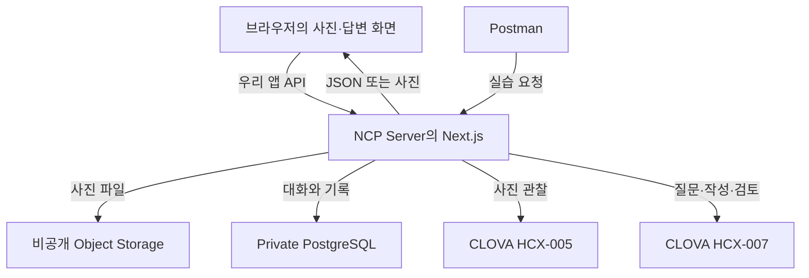
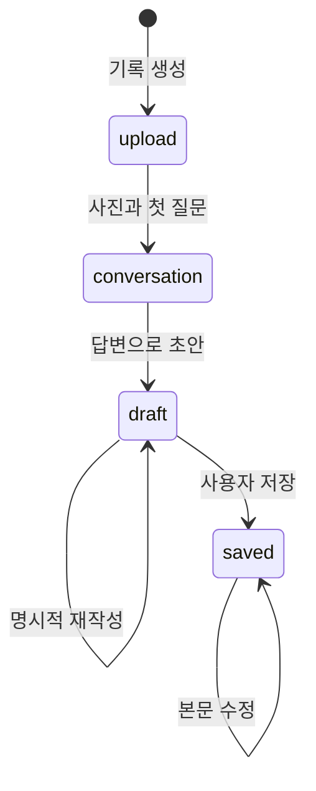

# 사진 너머 — 사진에서 시작해 내 말로 남기는 하루

사진 너머는 사진을 보며 기억나는 일을 답하면, 그 답변을 일기로 정리해 저장하는 웹앱입니다.
사진 속 물건을 설명하는 데서 그치지 않고, 사진에 담기지 않은 상황과 대화를 사용자가 직접 떠올리도록 돕습니다.
사용자는 AI가 만든 글을 읽고 고친 다음 저장합니다.

이 README는 네트워크와 코딩을 처음 배우는 사람을 위한 설명서입니다.
실행 명령만 복사하는 데서 끝나지 않도록, 어느 컴퓨터에서 무엇이 실행되고 어느 파일이 그 일을 하는지 함께 설명합니다.
처음부터 모든 문법을 외울 필요는 없습니다.
앱을 한 번 사용한 뒤 눌렀던 버튼이 서버까지 어떻게 이어지는지 따라가면 됩니다.

## 차례

1. [프로젝트의 목적과 범위](#1-프로젝트의-목적과-범위)
2. [작업하는 창부터 구분하기](#2-작업하는-창부터-구분하기)
3. [내 PC에서 처음 실행하기](#3-내-pc에서-처음-실행하기)
4. [사진 한 장으로 앱을 끝까지 사용하기](#4-사진-한-장으로-앱을-끝까지-사용하기)
5. [전체 구조: 화면에서 저장소까지](#5-전체-구조-화면에서-저장소까지)
6. [코드를 읽기 위한 기초](#6-코드를-읽기-위한-기초)
7. [답변 보내기 버튼을 코드로 따라가기](#7-답변-보내기-버튼을-코드로-따라가기)
8. [네트워크를 처음부터 이해하기](#8-네트워크를-처음부터-이해하기)
9. [NCP와 환경 설정](#9-ncp와-환경-설정)
10. [PC를 꺼도 실행되는 서버와 HTTPS](#10-pc를-꺼도-실행되는-서버와-https)
11. [전체 API와 Postman 실습](#11-전체-api와-postman-실습)
12. [기록의 상태와 데이터 구조](#12-기록의-상태와-데이터-구조)
13. [쿠키와 내 기록](#13-쿠키와-내-기록)
14. [사진 처리와 AI](#14-사진-처리와-ai)
15. [재시도와 동시에 저장하는 문제](#15-재시도와-동시에-저장하는-문제)
16. [파일별 역할과 수정 위치](#16-파일별-역할과-수정-위치)
17. [검사·배포·개발 이력](#17-검사배포개발-이력)
18. [문제 해결과 개인정보](#18-문제-해결과-개인정보)
19. [심화 문서와 공식 자료](#19-심화-문서와-공식-자료)

## 1. 프로젝트의 목적과 범위

사진에는 장면이 남지만, 그때 왜 거기에 갔는지와 무슨 이야기를 했는지는 남지 않을 때가 많습니다.
빈 일기장 앞에서 하루를 처음부터 설명하기는 어렵지만, 사진과 구체적인 질문이 있으면 이야기를 시작하기 쉽습니다.
이 프로젝트는 질문과 기록 과정을 연결합니다.

아래는 기능을 설명하기 위한 가상 예시입니다.
실제 사용자의 사진이나 기록을 가져온 내용이 아닙니다.

| 순서 | 예시 |
|---|---|
| 사진의 단서 | 테이블 위에 음료가 보입니다. |
| 질문 | 이 사진을 찍던 순간에는 무엇을 하고 있었나요? |
| 사용자 답변 | 발표가 끝나서 친구와 쉬고 있었어요. |
| 이어지는 질문 | 발표가 끝난 뒤 어떤 이야기를 나눴나요? |
| 사용자 답변 | 준비하면서 힘들었던 부분을 얘기했어요. |
| 결과 | 사용자가 말한 상황과 대화를 일기 초안으로 정리합니다. |

AI가 친구와 만났다는 사실이나 즐거웠다는 감정을 사진만 보고 결정하지 않게 설계했습니다.
사진 관찰이 틀리면 사용자의 정정이 우선합니다.
결과를 그럴듯하게 길게 만드는 것보다 사용자가 말한 세부 내용을 남기는 것을 중요하게 봅니다.
질문과 원래 답변도 저장하며, 초안과 저장된 기록에서 펼쳐볼 수 있습니다.

| 기능 | 현재 코드의 동작 |
|---|---|
| 사진 | 기록 하나에 JPG·PNG·WebP 1~3장 |
| 질문 수 | 시작 전에 1~10개 선택, 기본값 3개 |
| 사진 확대 | 업로드·대화·초안·상세에서 확대와 좌우 이동 |
| 대화 | 질문 하나씩 답하거나 건너뛰기 |
| 조기 마무리 | 실제 답변이 하나 이상이면 현재까지의 답변으로 초안 생성 |
| 기록 | 제목·본문 수정, 저장, 목록·상세 조회, 삭제 |
| 원문 확인 | 질문과 원래 답변을 초안·완성 기록에서 확인 |
| 초안 재작성 | 저장 전 초안에서 버전을 확인하고 다시 생성 |
| 실행 모드 | 외부 AI 없는 `demo`, 실제 NCP를 사용하는 `ncloud` |
| 로그인 | 회원가입 대신 브라우저 익명 쿠키 |

이 저장소는 공개용으로 정리한 코드와 문서입니다.
실제 사용자 사진·일기·비밀 키·운영 접속 정보는 포함하지 않습니다.
문서의 `203.0.113.10`은 설명용 주소이며 실제 접속할 서버가 아닙니다.
명령을 서버에 적용할 때는 본인이 만든 서버의 공인 IP로 바꿉니다.

개발 과정에서는 실제 NCP의 DB 연결, systemd·Nginx 실행, 공인 HTTP 응답을 확인했습니다.
그 뒤 추가한 HCX-007 글쓰기와 HTTPS 설정은 이번 코드 준비 시점에 운영 서버 적용을 확인한 결과가 아닙니다.
로컬 빌드와 자동 검사가 성공해도 실제 계정의 모델 이용 권한이나 글쓰기 품질까지 확인된 것은 아닙니다.
검증 범위는 [검증 기록](docs/VERIFICATION.md)에서 구분합니다.

| 확인 방법 | 알 수 있는 것 | 이것만으로 알 수 없는 것 |
|---|---|---|
| 빌드 | 실행용 코드로 만들 수 있는지 | 실제 클라우드 접속 성공 |
| 모의 AI 검사 | 요청 형식과 실패 처리 | 실제 모델 문장의 품질 |
| demo API 검사 | 입력·저장·권한·단계 규칙 | 실제 DB·스토리지 연결 |
| `/api/health` | 웹 서버가 응답하는지 | DB·사진·AI 정상 여부 |
| `/api/app` | 모드와 필수 설정값 존재 여부 | 설정값이 실제로 유효한지 |
| 실제 사진→저장 실습 | 그 환경에서 전체 경로가 작동하는지 | 모든 입력·장애 상황의 보장 |

## 2. 작업하는 창부터 구분하기

처음에는 문법보다 어느 창에 입력하는지에서 많이 막힙니다.
내 PC를 조작하는 터미널과 NCP 서버를 조작하는 터미널은 다릅니다.
명령을 실행하기 전에 현재 입력 표시를 읽으세요.

| 장소 | 보이는 표시의 예 | 여기서 하는 일 |
|---|---|---|
| 내 PC의 PowerShell | `PS C:\workspace>` | 코드 내려받기, 전송, 로컬 실행 |
| NCP 서버의 SSH 터미널 | `root@memory-app:~#` | Ubuntu 설치, 서버 앱 실행 |
| NCP 웹 콘솔 | 웹브라우저의 관리 화면 | 서버·VPC·DB·ACG 생성 |
| Postman | 요청 주소·Send 버튼 | 화면 없이 API 시험 |
| 앱 브라우저 | 사진과 답변 입력 화면 | 실제 서비스 사용 |

`PS ...>`와 `root@...#`는 프로그램이 보여 주는 안내입니다.
문서의 명령을 복사할 때 이 안내 표시까지 입력하지 않습니다.
명령이 끝나면 대개 입력 표시가 다시 나타납니다.
개발 서버나 SSH 터널은 계속 실행되므로 입력 표시가 돌아오지 않는 것이 정상일 수 있습니다.

`password:`가 보일 때는 요청한 비밀번호를 입력합니다.
글자나 별표가 표시되지 않아도 입력은 진행됩니다.
비밀번호를 명령 입력 줄이나 IP 입력 칸에 넣지 않습니다.
비밀번호는 채팅이나 Git 저장소에 올리지 않습니다.

PowerShell 명령을 CMD에 입력하면 `$env:USERPROFILE` 같은 문법을 이해하지 못합니다.
이 README의 Windows 예시는 PowerShell 기준입니다.
서버 예시는 Ubuntu의 Bash 기준이므로 Windows 창에 그대로 실행하지 않습니다.
한 줄이 성공했는지 보고 다음 줄로 넘어가면 원인을 찾기 쉽습니다.

## 3. 내 PC에서 처음 실행하기

### 3-1. 필요한 도구

Node.js는 서버 쪽 JavaScript를 실행하는 프로그램입니다.
npm은 필요한 라이브러리를 설치하고 프로젝트의 실행 명령을 관리합니다.
Git은 파일 변경 이력을 관리하고 저장소에서 코드를 내려받는 도구입니다.
코드를 고칠 때는 일반 문서 편집기보다 코드 편집기를 사용하는 편이 편합니다.

현재 `package.json`은 Node.js `22.13.0` 이상을 요구합니다.
NCP 설치 안내에서는 Node.js 24를 기준으로 설명합니다.
실제 설치되는 의존성 구성은 `package-lock.json`으로 맞춥니다.
내 PC의 PowerShell에서 다음 명령을 실행해 설치 여부를 확인합니다.

```powershell
node -v
npm.cmd -v
git --version
```

버전 숫자가 나오면 해당 프로그램이 준비된 것입니다.
`명령을 찾을 수 없다`는 오류는 설치되지 않았거나 실행 경로가 반영되지 않았다는 뜻입니다.
프로그램을 방금 설치했다면 PowerShell을 새로 열어 다시 확인합니다.

아직 설치하지 않았다면 다음 순서로 준비합니다.

1. [Node.js 공식 다운로드](https://nodejs.org/en/download)에서 Windows용 설치 파일을 받습니다. 이 안내와 맞추려면 24 버전을 선택합니다.
2. 설치 파일을 열어 안내를 따라 설치합니다. npm과 실행 경로를 추가하는 기본 선택을 유지합니다.
3. [Git 공식 Windows 설치 안내](https://git-scm.com/install/windows)에서 설치 파일을 받아 설치합니다.
4. 이미 열어 둔 PowerShell을 닫고 새로 연 뒤 위의 버전 확인 명령 세 개를 다시 실행합니다.

설치 파일을 내려받는 일, 설치 파일을 실행하는 일, 프로젝트에서 `npm ci`를 실행하는 일은 각각 다릅니다.
첫 두 단계는 프로그램 자체를 준비하고, `npm ci`는 이 프로젝트가 쓸 라이브러리를 준비합니다.
Ubuntu 서버는 설치 방법이 다르므로 [NCP 설정의 Node 설치](docs/NCLOUD_SETUP.md)를 따릅니다.

### 3-2. 코드 내려받기

다음 명령은 내 PC의 PowerShell에서 실행합니다.

```powershell
New-Item -ItemType Directory -Force "$env:USERPROFILE\Documents\projects"
Set-Location "$env:USERPROFILE\Documents\projects"
git clone https://github.com/tw-kang01/2026-NCP-Above-Picture.git
Set-Location .\2026-NCP-Above-Picture
```

`Set-Location`은 현재 작업 폴더를 바꿉니다.
이후 명령은 그 폴더 안에서 실행됩니다.
이미 코드를 내려받았다면 새로 clone하지 않고 해당 폴더로 이동합니다.
`Get-ChildItem package.json`으로 파일이 보이면 프로젝트 최상위에 들어온 것입니다.

### 3-3. 설치하고 켜기

```powershell
npm.cmd ci
npm.cmd run dev
```

`npm ci`는 잠금 파일에 기록된 구성대로 필요한 패키지를 설치합니다.
`node_modules`는 설치된 패키지가 들어가는 폴더이며 직접 작성한 코드와 구분합니다.
처음 설치하거나 의존성 구성이 바뀌었을 때 실행합니다.
매번 앱을 켤 때 반복할 필요는 없습니다.

`npm run dev`는 수정하면서 확인하는 개발 서버를 켭니다.
`Ready`가 나오면 브라우저에서 아래 주소를 엽니다.

```text
http://127.0.0.1:3000
```

기본 모드는 `demo`입니다.
NCP 키가 없어도 사진 선택, 질문, 답변, 초안, 저장 흐름을 사용할 수 있습니다.
실제 사진 분석이나 외부 AI 요청은 일어나지 않습니다.
준비된 질문과 사용자 답변으로 기능을 체험합니다.

### 3-4. 종료·재실행·빌드

서버를 실행한 PowerShell에서 `Ctrl+C`를 누르면 로컬 앱이 중지됩니다.
다시 쓸 때는 프로젝트 폴더에서 `npm.cmd run dev`를 실행합니다.
브라우저만 닫는 것은 개발 서버 종료와 다릅니다.
PC를 끄면 그 PC의 개발 서버도 멈춥니다.

실행용 빌드를 확인할 때는 다음 순서를 사용합니다.

```powershell
npm.cmd run build
npm.cmd start
```

`build`는 배포용 결과를 `.next`에 준비합니다.
`start`는 준비된 결과로 서버를 실행합니다.
같은 3000번 포트를 사용하므로 기존 `dev`를 먼저 종료합니다.
소스를 수정했다면 다시 빌드해야 실행용 결과에도 수정이 반영됩니다.

## 4. 사진 한 장으로 앱을 끝까지 사용하기

처음 실습에는 공개해도 되는 직접 만든 테스트 이미지를 사용하세요.
실제 인물이나 주소 없이도 기능을 익힐 수 있습니다.
`scripts/fixtures/test-photo.png`는 자동 검사에 쓰는 이미지입니다.

1. 첫 화면에서 새 기억을 남기는 버튼을 누릅니다.
2. 기억의 날짜와 선택 사항인 장소를 입력합니다.
3. 질문 수를 고릅니다. 처음에는 3개면 충분합니다.
4. 사진을 한 장 고르고 미리보기를 확인합니다.
5. 시작 버튼을 눌러 첫 질문을 기다립니다.
6. 질문에 답변하고 다음 질문으로 이동합니다.
7. 충분히 이야기했다면 현재까지의 답변으로 초안을 만듭니다.
8. 질문과 답변 원문을 펼쳐 빠진 내용이 있는지 확인합니다.
9. 제목과 본문을 직접 고치고 저장합니다.
10. 목록으로 돌아갔다가 같은 기록을 다시 엽니다.

사진을 누르면 확대하고 여러 장이면 좌우로 넘길 수 있습니다.
닫기 버튼이나 `Esc`로 닫습니다.
확대는 새 업로드가 아니라 이미 선택했거나 저장한 사진을 크게 보여 주는 화면 동작입니다.

질문을 건너뛸 수 있지만 답변이 하나도 없는 초안은 만들지 않습니다.
AI가 대신 사건을 지어내지 않으려면 근거가 되는 사용자 답변이 필요합니다.
선택한 질문 수를 모두 채우기 전에도 실제 답변이 하나 있으면 정리할 수 있습니다.

초안 생성과 최종 저장은 다릅니다.
초안은 서버에 남지만 입력창에서 추가로 고친 문장은 저장 버튼이 성공해야 반영됩니다.
저장 전 초안을 다시 생성하면 현재 편집 내용이 바뀔 수 있으므로 안내를 읽고 실행합니다.
이미 저장한 기록은 자동 재작성 대상이 아니며 직접 수정할 수 있습니다.

## 5. 전체 구조: 화면에서 저장소까지

이 프로젝트는 Next.js 하나 안에 화면과 서버 API를 함께 둡니다.
프론트엔드는 사용자가 보는 화면이고, 백엔드는 요청을 검사하고 저장하는 서버 기능입니다.
한 프로젝트에 있어도 실행 위치와 책임은 구분됩니다.
비밀 키를 쓰는 코드는 서버 쪽에 둡니다.



Postman은 운영 서비스의 중간 서버가 아닙니다.
개발자가 브라우저 대신 요청을 보내 보는 도구입니다.
일반 사용자는 Postman을 설치하지 않아도 앱을 쓸 수 있습니다.

| 부분 | 하는 일 | 대표 파일 |
|---|---|---|
| 화면 | 입력·버튼·현재 단계 표시 | `src/components/MemoryApp.js` |
| 화면 부품 | 카드·사진 목록·원문·확대창 | `src/components/` |
| 브라우저 통신 | 입력값을 HTTP 요청으로 바꾸기 | `src/lib/client/memory-api.js` |
| 서버 입구 | URL과 요청 방식을 함수에 연결 | `src/app/api/` |
| 업무 규칙 | 답변 단계·사진 수·저장 조건 | `src/lib/server/app/service.js` |
| 저장 | 파일 또는 DB 읽기·쓰기 | `src/lib/server/app/repository.js` |
| 외부 서비스 | CLOVA·Object Storage 연결 | `src/lib/server/` |

화면이 직접 DB 비밀번호를 받아 PostgreSQL에 접속하지 않습니다.
화면은 우리 서버에 요청하고 서버가 허용된 작업을 수행합니다.
화면을 바꿔도 저장 규칙은 서버에서 유지합니다.
화면의 검사를 우회한 요청도 서버가 다시 검사합니다.

## 6. 코드를 읽기 위한 기초

### 6-1. 파일과 확장자

파일은 이름이 있는 내용 묶음이고 폴더는 파일을 모으는 장소입니다.
이름 끝의 확장자는 파일의 용도를 짐작하게 해 줍니다.
확장자가 같아도 실제 역할은 위치와 내용으로 확인합니다.

| 확장자 | 이 프로젝트에서의 용도 |
|---|---|
| `.js` | 화면과 서버의 JavaScript 코드 |
| `.mjs` | 모듈 형식의 JavaScript 설정·검사 |
| `.css` | 색·간격·화면 배치 |
| `.json` | 이름과 값으로 저장한 설정·데이터 |
| `.md` | GitHub에서 읽는 Markdown 설명서 |
| `.sh` | Ubuntu Bash에서 실행하는 설치 절차 |
| `.ps1` | Windows PowerShell에서 실행하는 절차 |

### 6-2. 값과 변수

값은 글자·숫자·참거짓 같은 실제 내용입니다.
변수는 그 값을 나중에 다시 쓰도록 붙인 이름입니다.
아래는 JavaScript를 읽는 연습이며 터미널 명령이 아닙니다.

```javascript
const place = "동네 카페";
const questionLimit = 3;
const skipped = false;
```

`const`는 이 이름에 다른 값을 다시 대입하지 않겠다는 선언입니다.
`"동네 카페"`는 문자열, `3`은 숫자, `false`는 참거짓 값입니다.
따옴표가 있는 `"false"`는 글자이므로 `false`와 다릅니다.
서버는 `skipped`가 실제 참거짓 값인지 확인합니다.

### 6-3. 객체와 배열

객체는 관련 값을 이름으로 묶고 배열은 여러 항목을 순서대로 담습니다.
기록 하나는 객체이고 기록의 여러 사진은 배열입니다.

```javascript
const memory = {
  date: "2026-10-29",
  place: "동네 카페",
  questionLimit: 3,
  photos: [],
};
```

`memory.place`는 이 기록의 장소를 읽는 표현입니다.
`photos: []`는 아직 사진 항목이 없다는 뜻입니다.
중괄호와 대괄호는 서로 다른 역할을 합니다.
필드 이름을 바꾸면 화면·서버·검사·문서를 함께 확인해야 합니다.

### 6-4. 함수와 인자

함수는 이름을 붙여 다시 실행할 수 있게 만든 일의 묶음입니다.
함수에 넘기는 재료를 인자라고 부르고 괄호를 붙여 실행하는 것을 호출이라고 합니다.

```javascript
function questionLabel(current, total) {
  return `질문 ${current} / ${total}`;
}

const label = questionLabel(1, 3);
```

결과는 `질문 1 / 3`입니다.
`return`은 만든 결과를 돌려줍니다.
화면의 `submitAnswer`는 답변 제출을 실행하고 `memoryApi.answer`는 필요한 요청을 보냅니다.
이름이 비슷해도 어느 파일에 있는지 함께 읽어야 합니다.

### 6-5. 조건과 반복

조건은 상황에 따라 다른 일을 하게 합니다.
반복은 여러 항목에 같은 작업을 적용합니다.
예를 들어 사진이 세 장을 넘으면 거절하고 각 사진은 하나씩 검사합니다.

```javascript
if (photos.length > 3) {
  throw new Error("사진은 3장까지입니다.");
}

const names = photos.map((photo) => photo.name);
```

`length`는 배열의 항목 수입니다.
`map`은 각 항목을 바꿔 새 배열을 만듭니다.
`filter`는 조건에 맞는 항목만 남기고 `find`는 맞는 항목 하나를 찾습니다.
서버가 실제 답변이 있는 질문만 골라 초안 재료로 만드는 부분에도 이 표현이 나옵니다.

### 6-6. 비동기와 await

서버 응답이나 파일 저장은 즉시 끝나지 않을 수 있습니다.
`await`는 해당 결과를 기다린 뒤 다음 줄로 진행하게 합니다.
`try`와 `catch`는 성공 경로와 오류 경로를 구분할 때 사용합니다.

```javascript
const data = await memoryApi.get(memoryId);
const memory = data.memory;
```

첫 줄이 성공해야 둘째 줄에서 받은 기록을 사용할 수 있습니다.
실패하면 오류 처리로 넘어갑니다.
아직 받지 못한 결과를 성공 화면처럼 보여 주지 않습니다.

### 6-7. React 상태

React는 현재 값을 바탕으로 화면을 만듭니다.
입력이나 서버 응답으로 상태가 바뀌면 화면이 다시 계산됩니다.
상태를 바꿨다는 것과 서버에 저장했다는 것은 다릅니다.

```javascript
const [answer, setAnswer] = useState("");
```

`answer`는 현재 입력값이고 `setAnswer`는 값을 바꾸는 함수입니다.
타이핑하면 화면 상태가 바뀝니다.
답변 보내기 API가 성공해야 서버 기록에도 반영됩니다.
새로고침 전에 저장하지 않은 제목·본문이 사라질 수 있는 이유입니다.

### 6-8. JSON과 주석

JSON은 프로그램끼리 주고받기 편하도록 정한 글자 형식입니다.
필드 이름과 문자열에는 큰따옴표를 쓰며 마지막 항목 뒤에는 쉼표를 붙이지 않습니다.
JavaScript 주석은 코드를 읽는 사람에게 설명을 남깁니다.

```javascript
// 같은 질문에 같은 답변을 재전송하면 중복 저장하지 않습니다.
```

주석은 코드가 하는 일과 검사를 하는 이유를 설명해야 합니다.
코드를 바꾸고 주석을 그대로 두면 오해가 생깁니다.
이 저장소는 함수의 역할·입출력·실패 처리를 한국어로 설명합니다.
실제 실행 규칙은 코드와 검사 결과가 기준입니다.

## 7. 답변 보내기 버튼을 코드로 따라가기

모든 파일을 순서대로 읽기보다 한 행동의 왕복 경로를 따라가 보세요.
여기서는 답변 입력 후 다음 질문을 받는 과정을 봅니다.
파일을 열고 아래 함수 이름을 검색하면 위치를 찾을 수 있습니다.

```text
MemoryApp.js의 submitAnswer
  → memory-api.js의 memoryApi.answer
  → answers/route.js의 POST
  → app/http.js의 appRespond
  → service.js의 answer
  → ai.js의 nextQuestionTurn / repository.js의 saveMemory
  → JSON 응답
  → MemoryApp.js의 상태 갱신
```

### 7-1. 화면에서 재료 모으기

`MemoryApp.js`는 현재 기록·현재 질문·입력한 답변을 알고 있습니다.
빈 답변과 중복 클릭을 먼저 검사하고 통신 중에는 기다리는 상태를 보여 줍니다.
화면 검사는 실수를 줄이기 위한 첫 검사이며 서버 검사를 대신하지 않습니다.

### 7-2. 통신 함수가 요청 만들기

`memory-api.js`는 다음 값을 JSON으로 바꿔 `POST` 요청에 넣습니다.

```json
{
  "questionId": "서버에서 받은 현재 질문 ID",
  "answer": "발표가 끝나서 친구와 쉬고 있었어요.",
  "skipped": false
}
```

주소에는 기록 ID가, 본문에는 질문 ID가 들어갑니다.
두 ID는 서로 다릅니다.
같은 사이트의 쿠키도 브라우저가 함께 전송합니다.

### 7-3. 서버 입구에서 처리 함수로 연결

`src/app/api/memories/[id]/answers/route.js`는 해당 주소의 POST를 받습니다.
`[id]`는 실제 기록 ID가 들어오는 자리입니다.
입구 파일은 URL 값을 읽고 공통 응답과 업무 함수에 연결합니다.
질문 생성 규칙 전체를 이 작은 파일에 넣지는 않습니다.

### 7-4. 소유자·입력·현재 단계 검사

`appRespond`는 쿠키로 소유자를 구분하고 다른 사이트에서 온 변경 요청을 검사합니다.
`service.js`의 `answer`는 그 소유자의 기록인지 다시 조회합니다.
대화 단계인지, 현재 질문인지, skipped가 참거짓 값인지 확인합니다.
일반 답변은 비어 있으면 안 되고 2,000자 이하여야 합니다.

### 7-5. 다음 질문과 저장

서버는 이번 답변을 반영한 질문 목록을 준비합니다.
질문 수가 남았다면 그 목록을 참고해 다음 질문을 만듭니다.
이 과정까지 성공하면 기록을 저장하고 버전을 올립니다.
AI 호출이 실패했는데 변경이 성공했다고 응답하지 않습니다.

### 7-6. 응답을 다시 화면에 반영

성공 응답의 `data.memory`에는 서버에 반영된 기록이 있습니다.
화면은 그 값을 현재 기록에 넣고 다음 질문이나 초안 만들기를 보여 줍니다.
실패 응답이면 입력한 답변을 유지하고 오류를 안내합니다.

브라우저 개발자 도구의 Network 탭에서도 이 과정을 볼 수 있습니다.
`answers` 요청의 Payload와 Response를 비교합니다.
입력한 문장이 `answer`에 있고 응답의 `turns`에 반영됐는지 봅니다.
실제 답변과 쿠키가 보일 수 있으므로 그 화면을 그대로 공개하지 않습니다.

## 8. 네트워크를 처음부터 이해하기

### 8-1. 클라이언트와 서버

클라이언트는 요청을 보내고 서버는 요청을 처리합니다.
브라우저와 앱 서버의 관계에서는 브라우저가 클라이언트입니다.
앱 서버가 CLOVA에 요청할 때는 앱 서버가 그 통신의 클라이언트입니다.
컴퓨터 이름이 아니라 해당 통신에서의 역할을 가리킵니다.

### 8-2. IP 주소와 공인·사설 주소

IP는 네트워크에서 목적지를 찾는 주소입니다.
공인 IP는 인터넷에서 서버에 접근할 때 사용합니다.
사설 IP는 내부에서 앱 서버와 DB 같은 자원이 통신할 때 사용합니다.
이번 구조는 DB를 인터넷에 공개하지 않고 내부 주소로 연결합니다.

문서의 `203.0.113.10`은 설명용 예약 주소입니다.
실제 서비스가 열리지 않으므로 본인의 공인 IP로 바꿔야 합니다.
예시 사설 대역도 계정에서 생성한 실제 구성과 맞춥니다.
다른 사람의 실제 서버 주소를 문서에 넣을 필요는 없습니다.

### 8-3. 127.0.0.1

`127.0.0.1`은 현재 요청하는 컴퓨터 자신을 가리킵니다.
내 PC 브라우저의 127.0.0.1은 내 PC입니다.
NCP 서버 터미널의 127.0.0.1은 NCP 서버입니다.
같은 글자지만 서로 다른 컴퓨터입니다.

휴대폰에서 `127.0.0.1:3000`을 열면 휴대폰 자신의 3000번을 찾습니다.
내 PC나 NCP 앱에 연결되는 주소가 아닙니다.
다른 기기에서 사용하려면 외부 접근 가능한 서버와 주소가 필요합니다.
운영 앱은 Nginx를 통해 공인 주소로 받도록 구성합니다.

### 8-4. 포트와 URL

포트는 같은 컴퓨터 안에서 통신을 받을 프로그램을 구분하는 번호입니다.
주소의 `:3000`이 포트 표기입니다.
URL은 통신 방식·주소·필요하면 포트·요청 경로를 표현합니다.

```text
http://127.0.0.1:3000/api/app
  │         │      │      └─ 요청할 경로
  │         │      └─ 포트
  │         └─ 목적지 주소
  └─ 통신 방식
```

| 포트 | 프로젝트에서의 용도 |
|---|---|
| 22 | 관리자 SSH 접속 |
| 80 | HTTP와 인증서 소유 확인 |
| 443 | HTTPS |
| 3000 | 서버 내부 Next.js 앱 |
| 5432 | PostgreSQL 연결 |
| 53 | DNS 조회 |
| 123 | 시간 동기화 |

외부 이용자가 3000이나 DB의 5432에 직접 접근할 필요는 없습니다.
외부 웹 요청은 Nginx가 받고 내부 앱에 전달합니다.
서버 내부에서 응답이 나온다고 외부에서도 열리는 것은 아닙니다.
방화벽과 라우팅도 확인해야 합니다.

### 8-5. DNS와 도메인

도메인은 사람이 읽기 쉬운 이름이고 DNS는 그 이름에 연결된 주소를 찾는 체계입니다.
도메인 구매, DNS 등록, 서버의 앱 실행은 서로 다른 일입니다.
NCP Global DNS에 이름을 연결한다고 코드가 자동 실행되지는 않습니다.
이 프로젝트는 도메인이 없어도 공인 IP로 접근하는 절차를 준비했습니다.

### 8-6. HTTP의 요청과 응답

HTTP는 웹의 요청·응답 약속입니다.
요청에는 어디에 무엇을 부탁하는지가, 응답에는 상태와 결과가 들어갑니다.
오류 안내가 나와도 서버까지 통신 자체는 성공했을 수 있습니다.

| 방식 | 뜻 | 앱의 예 |
|---|---|---|
| GET | 읽기 | 기록 목록 조회 |
| POST | 새 작업 수행 | 기록 생성·답변 제출 |
| PATCH | 일부 내용 변경 | 제목·본문 저장 |
| DELETE | 삭제 | 기록·사진 삭제 |

### 8-7. HTTPS와 TLS

HTTPS는 TLS로 암호화하고 인증서를 확인하는 HTTP입니다.
브라우저가 주소와 인증서를 검증하면서 암호화 통로를 만듭니다.
HTTP만 설치된 서버의 주소를 HTTPS로 바꾼다고 자동 설정되지 않습니다.
443번 수신, 유효한 인증서, Nginx 설정이 함께 필요합니다.

HTTPS는 통신 구간을 보호합니다.
DB 백업이나 사용자 권한 검사까지 대신하지는 않습니다.
앱은 별도로 소유자와 입력을 검사합니다.
사진과 답변은 AI 처리를 위해 CLOVA에 전달될 수 있으므로 처리 구조도 이해해야 합니다.

### 8-8. VPC·Subnet·CIDR

VPC는 클라우드에 만드는 프로젝트용 네트워크 공간입니다.
Subnet은 그 공간을 나눈 구역입니다.
이번 구성은 앱용 Public Subnet과 DB용 Private Subnet을 둡니다.
Public이라는 이름만으로 모든 포트가 공개되는 것은 아닙니다.

| 자원 | 예시 범위 | 목적 |
|---|---|---|
| VPC | `10.20.0.0/16` | 전체 내부 네트워크 |
| 앱 Subnet | `10.20.1.0/24` | 공인 IP가 연결된 앱 서버 |
| DB Subnet | `10.20.2.0/24` | 내부 연결용 DB |

`/16`, `/24`, `/32`처럼 주소 범위를 표현하는 방식을 CIDR이라고 합니다.
먼저 `/32`는 IPv4 주소 하나라는 점을 이해하면 됩니다.
SSH 소스를 내 PC 주소 하나로 제한할 때 사용합니다.
`0.0.0.0/0`은 모든 IPv4를 뜻하므로 방향과 포트를 함께 읽어야 합니다.

### 8-9. ACG·Inbound·Outbound

ACG는 서버의 통신 허용 규칙입니다.
Inbound는 들어오는 요청, Outbound는 나가는 요청입니다.
SSH가 된다고 외부 다운로드도 된다는 뜻은 아닙니다.
직접 만든 ACG는 두 방향 모두 확인해야 합니다.

| 대상 | 방향 | 허용할 내용 |
|---|---|---|
| 앱 | Inbound | 내 PC 공인 IP/32 → TCP 22 |
| 앱 | Inbound | 웹 사용자 → TCP 80·443 |
| 앱 | Outbound | 외부 HTTPS·설치·DNS·시간 동기화 |
| 앱 | Outbound | DB 내부 대역 → TCP 5432 |
| DB | Inbound | 앱 서버 ACG → TCP 5432 |

DB에는 ACG 외에 DB 사용자 접근 제어도 있습니다.
네트워크 문이 열려도 계정·암호·허용 주소가 다르면 접속에 실패합니다.
통신 허용과 계정 인증은 따로 확인합니다.
실제 입력 예시는 [NCP 설정](docs/NCLOUD_SETUP.md)에 있습니다.

### 8-10. SSH·scp·터널

SSH는 암호화 연결로 서버에 접속해 명령을 실행합니다.
scp는 SSH로 파일을 복사합니다.
SSH 터널은 내 PC 포트를 서버 내부 포트에 연결하는 개발용 접근 방법입니다.
공인 웹 운영에서는 사용자 요청이 내 PC 터널을 거칠 필요가 없습니다.

```text
초기 실습: 내 PC :13000 → SSH 터널 → 서버 내부 :3000
공개 운영: 브라우저 → 서버 Nginx :443 → 서버 내부 :3000
```

## 9. NCP와 환경 설정

NCP는 NAVER Cloud Platform입니다.
이 앱은 실행·사진·기록·AI 처리에 NCP를 사용합니다.
자원 생성은 코드 설치와 별개이며 계정 권한과 과금 조건을 확인해야 합니다.
저장소를 clone하는 것만으로 클라우드 자원이 생성되지는 않습니다.

| 서비스 | 맡기는 일 |
|---|---|
| Server | Next.js와 Nginx 실행 |
| VPC·Subnet·ACG | 통신 경로·접근 허용 |
| Cloud DB for PostgreSQL | 질문·답변·기록·사진 연결 정보 |
| Object Storage | 비공개 사진 파일 |
| CLOVA Studio | 사진 관찰·질문·작성·검토 |

준비 순서는 다음과 같습니다.

1. CLOVA Studio와 필요한 모델의 API 권한을 확인합니다.
2. VPC와 앱·DB용 Subnet을 만듭니다.
3. 앱 ACG의 Inbound·Outbound를 설정합니다.
4. Ubuntu 서버와 공인 IP를 준비합니다.
5. SSH로 접속해 Node.js와 기본 도구를 설치합니다.
6. 비공개 버킷과 스토리지 접근 키를 준비합니다.
7. Private PostgreSQL과 DB 사용자 접근 제어를 준비합니다.
8. 서버에 코드를 내려받고 `.env.local`을 작성합니다.
9. DB·스토리지·각 모델을 실제 확인합니다.
10. 빌드·자동 실행·HTTPS 순서로 적용합니다.

서비스 신청과 키 발급만으로 연결이 끝난 것은 아닙니다.
`configured:true`도 필요한 설정값이 존재한다는 뜻입니다.
사진 업로드부터 질문·초안·저장·재조회까지 확인해야 전체 경로를 검증할 수 있습니다.
HCX-005 권한과 HCX-007 권한도 각각 확인합니다.

### 9-1. 환경 변수

환경 변수는 실행 환경마다 다른 값을 코드 밖에서 전달하는 방법입니다.
같은 코드로 demo와 실제 클라우드를 다르게 실행하거나 비밀 키를 전달할 때 사용합니다.
실제 값은 `.env.local`에 두고 저장소에는 빈 예시만 둡니다.
비밀 값에 `NEXT_PUBLIC_` 접두사를 붙이지 않습니다.

로컬 체험 설정을 명시하려면 PowerShell에서 복사합니다.

```powershell
Copy-Item .env.example .env.local
```

예시의 기본값은 demo라 실제 키 없이 실행됩니다.
NCP에서는 서버의 `.env.local`을 편집합니다.
등호 뒤 내용은 파일의 값이지 터미널 명령이 아닙니다.
설정을 바꾼 뒤에는 앱을 재시작해야 반영됩니다.

```dotenv
APP_MODE=ncloud
APP_DATA_DIR=.data
APP_PUBLIC_ORIGIN=http://203.0.113.10
APP_COOKIE_SECURE=false
NCP_ACCESS_KEY=
NCP_SECRET_KEY=
NCP_BUCKET=
PGHOST=
PGPORT=5432
PGDATABASE=memorydb
PGUSER=memoryapp
PGPASSWORD=
CLOVA_STUDIO_API_KEY=
```

IP는 본인의 주소로 바꾸고 빈 항목은 생성·발급한 값으로 채웁니다.
실제 키를 예시 파일에 넣어 커밋하지 않습니다.
HTTPS 스크립트는 서비스의 공개 주소와 Secure 쿠키를 함께 바꿉니다.
NCP의 실제 호스트·버킷도 본인 실행 환경에서 관리합니다.

### 9-2. 네 종류의 인증 정보

| 인증 정보 | 사용하는 곳 | 구분 |
|---|---|---|
| 서버 관리자 인증 | SSH·scp | DB 암호와 다릅니다. |
| DB 사용자·암호 | PostgreSQL | 서버 root 암호와 다릅니다. |
| NCP Access·Secret Key | Object Storage 요청 서명 | CLOVA 키와 다릅니다. |
| CLOVA Studio API 키 | 모델 호출 | 스토리지 Secret Key와 다릅니다. |

설정 파일은 서버에서 `chmod 600 .env.local`로 소유자만 읽게 관리합니다.
실제 키를 채팅·GitHub·캡처에 넣지 않습니다.
이미 공개된 비밀 키는 파일에서 지우는 것만으로 해결되지 않습니다.
발급처에서 폐기·재발급해야 합니다.

## 10. PC를 꺼도 실행되는 서버와 HTTPS

### 10-1. systemd와 Nginx

내 PC 개발 서버는 PC와 함께 멈춥니다.
SSH에서 직접 켠 프로그램도 연결·실행 방식에 영향을 받습니다.
운영에서는 NCP의 systemd가 앱을 관리하고 Nginx가 외부 요청을 받습니다.
PC는 관리 도구가 되고 실행 주체는 NCP 서버가 됩니다.

systemd는 Ubuntu에서 서비스를 시작·중지하고 재부팅 후 다시 켜는 관리 체계입니다.
스크립트는 `photo-memory.service`를 만들고 별도 사용자로 앱을 실행합니다.
Node 실행 파일도 전용 경로에 준비합니다.
앱이 종료되면 다시 시작하게 설정합니다.

Nginx는 80·443 요청을 내부 `127.0.0.1:3000`에 전달합니다.
이 역할을 역방향 프록시라고 부릅니다.
인증서 처리도 Nginx가 맡습니다.
앱의 3000번 포트는 인터넷에 직접 열 필요가 없습니다.

Ubuntu 서버에서 설정과 설치를 준비한 뒤 실행합니다.

```bash
cd /root/photo-memory-app
npm ci
npm run build
bash scripts/install-ncp-service.sh 203.0.113.10
```

이는 실제 서버 설정을 변경하는 명령입니다.
본인의 IP로 바꾸고 `.env.local`을 준비한 서버에서 실행합니다.
서비스·실행 파일·Nginx를 배치하면서 앱이 잠시 재시작될 수 있습니다.
상세 절차는 [자동 실행](docs/ALWAYS_ON_NCP.md)을 읽습니다.

```bash
systemctl is-active photo-memory nginx
systemctl is-enabled photo-memory nginx
curl -sS http://127.0.0.1:3000/api/app
```

`active`는 현재 실행 중, `enabled`는 부팅 시 시작하도록 등록됐다는 뜻입니다.
내부 점검 뒤 휴대폰 Wi-Fi를 끄고 실제 공인 주소로 확인합니다.
PC 터미널을 닫고도 접속되면 터널에 의존하지 않는지 확인할 수 있습니다.
NCP 서버 자체는 운영 중으로 유지해야 합니다.

### 10-2. IP HTTPS

공인 IP용 HTTPS 스크립트가 포함되어 있습니다.
Let’s Encrypt의 짧은 유효기간 IP 인증서와 이를 지원하는 Certbot을 사용합니다.
약 6일짜리 인증서는 자동 갱신이 필요합니다.
실제 발급·갱신 성공은 해당 서버에서 검증해야 합니다.

먼저 HTTP 자동 실행을 끝내고 앱 ACG의 TCP 80·443을 허용합니다.
그다음 서버에서 실행합니다.

```bash
bash scripts/enable-ncp-https.sh 203.0.113.10
```

스크립트는 Certbot 설치와 인증서 발급을 요청합니다.
Let’s Encrypt 이용 약관 동의 옵션이 포함되어 있습니다.
인증서 소유 확인용 HTTP 경로는 유지하고 나머지 HTTP 요청은 HTTPS로 이동시킵니다.
Nginx·앱 공개 주소·Secure 쿠키를 함께 맞춥니다.

갱신 점검은 systemd 타이머가 약 6시간마다 수행하게 구성합니다.
갱신 후 Nginx가 새 인증서를 읽도록 다시 불러옵니다.
타이머가 있다는 것과 실제 갱신 성공은 다르므로 dry-run 결과도 확인합니다.
명령과 실패 복구는 [HTTPS 안내](docs/HTTPS_NCP.md)에 있습니다.

```bash
systemctl list-timers photo-memory-cert-renew.timer
openssl x509 -in /etc/letsencrypt/live/photo-memory-ip/fullchain.pem -noout -dates
```

인증서를 무시하는 옵션으로 성공했다고 판단하지 않습니다.
일반 브라우저에서 경고 없이 열리고 HTTP가 HTTPS로 이동하는지 봅니다.
같은 호스트의 기존 HTTP 쿠키는 HTTPS 전환 시 같은 식별값을 유지합니다.
다른 도메인·브라우저로 접속하는 문제는 별도로 구분합니다.

## 11. 전체 API와 Postman 실습

### 11-1. API 목록

API는 프로그램끼리 무엇을 보내고 받을지 정한 약속입니다.
우리 앱 API와 CLOVA API는 다릅니다.
브라우저는 아래 앱 API를 요청하고 서버가 필요한 외부 서비스를 호출합니다.
`{id}`와 `{photoId}`는 서버가 준 실제 값으로 바꿉니다.

| 방식 | 주소 | 역할 |
|---|---|---|
| GET | `/api/health` | 웹 서버 응답 확인 |
| GET | `/api/app` | 모드·설정 존재 여부·모델 구성 |
| GET | `/api/memories` | 내 기록 목록 |
| POST | `/api/memories` | 새 기록 생성 |
| GET | `/api/memories/{id}` | 내 기록 상세 |
| PATCH | `/api/memories/{id}` | 제목·본문 저장·수정 |
| DELETE | `/api/memories/{id}` | 기록과 사진 삭제 |
| POST | `/api/memories/{id}/photos` | files 업로드 |
| GET | `/api/memories/{id}/photos/{photoId}` | 권한 검사 후 사진 |
| POST | `/api/memories/{id}/start` | 관찰과 첫 질문 |
| POST | `/api/memories/{id}/answers` | 답변과 다음 질문 |
| POST | `/api/memories/{id}/draft` | 초안 생성·명시적 재작성 |

### 11-2. 응답 읽기

일반 성공 응답은 다음 모양입니다.

```json
{
  "ok": true,
  "data": { "memories": [] },
  "requestId": "요청마다 부여하는 확인 번호"
}
```

`ok`는 앱 처리의 성공 여부이고 `data`는 결과입니다.
`requestId`는 내용을 공개하지 않고 오류를 구분하는 번호입니다.
현재 생성·삭제도 정상 HTTP 상태는 200입니다.
사진 조회는 JSON 대신 사진 바이트를 돌려주고 health에는 공통 requestId가 없습니다.

실패 예시는 다음과 같습니다.

```json
{
  "ok": false,
  "error": {
    "code": "INVALID_DATE",
    "message": "실제 날짜를 YYYY-MM-DD 형식으로 입력해주세요."
  },
  "requestId": "오류 확인 번호"
}
```

| 상태 | 이해하는 방법 | 예 |
|---|---|---|
| 400 | 입력·작업 조건 확인 | 없는 날짜, 빈 답변 |
| 403 | 다른 출처의 변경 요청 | 허용하지 않은 Origin |
| 404 | 없거나 내 것이 아님 | 다른 쿠키의 기록 |
| 409 | 현재 단계·버전 충돌 | 대화 후 업로드, 오래된 저장 |
| 413 | 요청 본문이 큼 | 업로드 전체 한도 |
| 415 | 형식이 다름 | JSON 대신 일반 글 |
| 429 | 앱 요청 수 제한 | 짧은 시간의 과도한 변경 |
| 502·504 | 외부 AI 문제 | 인증·형식·연결·대기 초과 |
| 503 | 설정·처리량 확인 | 필수 값 누락, 동시 처리 한도 |

### 11-3. Postman 준비

Postman에서는 화면 없이 요청을 한 개씩 보낼 수 있습니다.
브라우저와 쿠키가 다르므로 Postman 안에서 새 기록을 만듭니다.
브라우저의 기록 ID만 복사하면 404가 나올 수 있습니다.
같은 PC의 두 프로그램도 쿠키를 자동 공유하지 않습니다.

`postman/photo-memory-app.postman_collection.json`을 Import합니다.
`base_url`은 로컬이면 `http://127.0.0.1:3000`입니다.
NCP이면 실제 사용하는 주소로 바꿉니다.
응답의 ID와 버전을 다음 요청에서 사용하는 순서를 지킵니다.

### 11-4. 새 기록 만들기

`GET /api/app`으로 모드를 확인하고 쿠키를 받습니다.
`POST /api/memories`의 Body를 raw·JSON으로 고릅니다.

```json
{
  "date": "2026-10-29",
  "place": "동네 카페",
  "questionLimit": 3
}
```

응답의 `data.memory.id`를 기록 ID로 사용합니다.
장소는 모르면 `""`로 보내지만 문자열 필드는 있어야 합니다.
날짜는 `2026-02-30`처럼 실제로 없는 값을 허용하지 않습니다.
질문 수는 글자 `"3"`이 아니라 숫자 `3`입니다.

### 11-5. 사진과 첫 질문

사진 주소에 POST할 때 Body는 form-data입니다.
Key는 `files`, 종류는 File로 고르고 유효한 사진을 선택합니다.
여러 장이면 같은 `files` 이름을 반복합니다.
multipart 경계가 들어가는 Content-Type은 Postman이 만들게 둡니다.

`POST /api/memories/{id}/start`에는 JSON을 보냅니다.

```json
{ "questionLimit": 3 }
```

질문 수를 생략할 때도 JSON 객체 `{}`를 보냅니다.
사진이 없으면 시작하지 못합니다.
첫 질문의 ID는 `data.memory.turns`에서 확인합니다.

### 11-6. 답변·초안·재작성

`POST /api/memories/{id}/answers`를 보냅니다.

```json
{
  "questionId": "현재 질문의 실제 UUID",
  "answer": "발표가 끝난 뒤 쉬고 있었어요.",
  "skipped": false
}
```

다음 질문이 생기면 새 질문 ID를 사용합니다.
건너뛰기는 `skipped:true`로 보냅니다.
적어도 하나의 실제 답변은 필요합니다.
초안을 만들 때는 draft 주소에 POST로 `{}`를 보냅니다.

이미 초안이 있으면 일반 요청은 기존 초안을 돌려줍니다.
저장 전 초안을 새로 생성하려면 현재 버전도 보냅니다.

```json
{
  "regenerate": true,
  "version": 5
}
```

`5`는 형식 예시입니다.
실제 값은 직전 응답의 최신 `memory.version`을 사용합니다.
재작성은 제목·본문을 교체하므로 직접 편집한 문장을 먼저 보관합니다.
이미 저장한 기록에는 이 재작성 요청을 허용하지 않습니다.

### 11-7. 최종 저장

`PATCH /api/memories/{id}`로 보냅니다.

```json
{
  "title": "발표 뒤의 휴식",
  "content": "발표를 마친 뒤 친구와 쉬었다. 준비하면서 힘들었던 부분을 이야기했다.",
  "version": 6
}
```

version은 실제 최신 값을 넣습니다.
성공 후 status가 saved인지 확인합니다.
같은 쿠키로 목록·상세를 조회해 내용이 유지되는지 봅니다.
테스트가 끝나면 자신이 만든 테스트 기록만 DELETE로 정리합니다.

## 12. 기록의 상태와 데이터 구조

상태는 기록이 어느 단계인지 나타냅니다.
화면에서 목록을 보는 것과 기록이 초안 단계인 것은 다릅니다.
`view` 같은 화면 상태와 `memory.status`를 구분합니다.



| 상태 | 가능한 일 |
|---|---|
| upload | 사진 추가·질문 수 확정·시작 |
| conversation | 답변·건너뛰기·초안 생성 |
| draft | 편집·재작성·저장 |
| saved | 읽기·원문 확인·직접 수정·삭제 |

| 필드 | 뜻 |
|---|---|
| id | 기록 UUID |
| date, place | 기억의 날짜·장소 |
| status | 기록 단계 |
| title, content | 제목·본문 |
| photos | 사진 ID·이름·앱 조회 경로 |
| turns | 질문·답변·건너뛰기 |
| questionLimit | 이 기록의 질문 수 |
| version | 성공한 변경 때 증가하는 번호 |
| createdAt, updatedAt | 생성·수정 시각 |
| mode | 생성할 때 실행 모드 |
| draftSource | demo·ai·answers 등 출처 |
| preservedAnswerCount | 원문 초안으로 남긴 답변 수 |
| writingModel | 작성 모델 또는 원문 사용 시 null |

서버 내부에는 소유자 해시·사진 저장 키·관찰문도 있습니다.
일반 응답에 이 값을 전부 보내지 않습니다.
DB에는 사진 바이트 대신 연결 정보가 들어갑니다.
사진 파일은 별도 저장소에 둡니다.

demo 기록은 `.data/memories/`의 JSON 파일입니다.
ncloud는 `app_memories` 테이블의 JSONB와 검색용 칼럼에 저장합니다.
JSONB는 객체 모양 데이터를 DB가 다룰 수 있게 보관하는 형식입니다.
질문마다 별도 관계형 테이블을 사용하는 구현은 아닙니다.

## 13. 쿠키와 내 기록

현재 실명·이메일 회원가입은 없습니다.
서버가 무작위 식별값을 쿠키로 보냅니다.
브라우저는 같은 사이트의 다음 요청에 그 값을 보냅니다.
서버는 SHA-256 해시로 바꿔 기록 소유자와 비교합니다.

| 항목 | 의미 |
|---|---|
| memory_session | 익명 세션 쿠키 이름 |
| HttpOnly | 화면 JavaScript가 직접 읽지 못함 |
| SameSite=Lax | 외부 사이트와의 전송을 일부 제한 |
| Secure | HTTPS로만 전송 |
| 1년 수명 | 만료 설정이며 영구 복구 보장이 아님 |

같은 PC도 다른 브라우저·시크릿 창이면 다른 사용자입니다.
쿠키를 지우면 DB 기록이 바로 삭제되지는 않지만 접근할 열쇠가 사라집니다.
계정 찾기나 쿠키 복구는 구현하지 않았습니다.
주소 변경 뒤에는 삭제를 단정하기 전에 호스트·브라우저·쿠키를 확인합니다.

localStorage에는 작성 중인 기록 ID를 기억합니다.
사진·전체 일기를 대신 저장하는 곳도 인증 열쇠도 아닙니다.
소유권은 서버가 쿠키로 확인합니다.
다른 기록 ID를 알아도 자신의 쿠키로는 조회되지 않게 처리합니다.

## 14. 사진 처리와 AI

### 14-1. 사진 전처리와 저장

브라우저는 원본 대신 전송용 사본을 만듭니다.
원본을 덮어쓰지 않습니다.
긴 변을 최대 1,600px로 줄여 JPEG로 다시 인코딩합니다.
투명 부분은 흰색으로 채웁니다.

| 위치 | 검사·처리 |
|---|---|
| 브라우저 | JPG·PNG·WebP, 원본 각 30MiB 이하 |
| 브라우저 | 8천만 화소 이하·지나친 가로세로 비율 제한 |
| 브라우저 | 긴 변 1,600px·JPEG 품질 0.86 |
| 브라우저 | 재인코딩으로 원본 EXIF 전송 제외 |
| 서버 | 각 파일 0보다 크고 5MiB 이하 |
| 서버 | 시작 바이트와 선언한 이미지 형식 비교 |
| 서버 | 합계 3장, 대화 시작 전만 추가 |

Postman은 이 축소 과정을 거치지 않습니다.
서버 한도에 맞는 사진을 준비합니다.
헤더 바이트 검사는 전체 이미지를 해독하는 검사와 다릅니다.
얼굴이나 글자를 자동으로 가리는 기능도 아닙니다.

Object Storage 사진은 비공개입니다.
브라우저는 앱 사진 API에서 소유자 검사 후 파일을 받습니다.
CLOVA에만 300초짜리 서명 URL을 전달합니다.
서명 URL은 유효한 동안 읽기 권한이 있으므로 공개하지 않습니다.

같은 이름·내용의 재업로드는 중복 추가하지 않습니다.
정규화한 파일명과 SHA-256 내용 지문을 비교합니다.
이름이 다르면 같은 내용도 별개 사진일 수 있습니다.
내용 지문은 파일 비교용이며 인물 식별 기능이 아닙니다.

### 14-2. AI 처리 흐름

사진은 HCX-005, 질문·작성·검토는 HCX-007을 사용합니다.
텍스트 작업은 `thinking.effort: high`로 요청합니다.
코드 설정과 실제 모델 이용 권한·품질은 별도로 확인합니다.

```text
사진 1~3장 → HCX-005 관찰
  → 날짜·장소·이전 대화로 HCX-007 질문
  → 중복 검사·필요 시 준비된 질문
  → 답변 전체로 HCX-007 작성
  → 원래 답변+초안으로 HCX-007 검토
  → JSON·답변 ID·분량 검사
  → 사용자 확인·수정·저장
```

관찰문은 질문의 참고 자료입니다.
일기 작성·검토에는 사진과 관찰문을 보내지 않습니다.
날짜·장소·사용자 답변을 근거로 쓰도록 입력을 나눴습니다.
질문에 들어 있는 잘못된 전제도 사실로 쓰지 않게 지시합니다.

### 14-3. 반복 질문과 글쓰기 보존

새 질문 응답은 `{"question":"짧은 한국어 질문 하나?"}` 형태로 요청합니다.
화면에는 120자 이내의 자연스러운 질문 하나만 보여 주고 Q1·마크다운·설계 이유를 넣지 않습니다.
서버는 질문 형식을 읽은 뒤 중복과 관점을 검사합니다.
여러 질문·분석·너무 긴 응답·출력 잘림은 준비된 질문으로 대체할 수 있습니다.

기존 기록은 확실하게 해석되는 Q1·굵게 표시·질문 뒤 설계 설명만 표시용 복사본에서 정리합니다.
DB의 원래 질문·ID·답변을 바꾸지는 않습니다.
해석할 수 없는 옛 문장을 임의의 새 질문으로 바꾸지도 않습니다.
그 경우 기존 표시가 남을 수 있으므로 기존 기록 전체가 자동 수정된다고 설명하지 않습니다.

질문은 상황·세부 장면·직전·직후·감각·사진을 남긴 이유 등 관점을 나눕니다.
문자열 유사도와 알려진 의도로 반복을 검사합니다.
중복이면 아직 쓰지 않은 관점의 준비된 질문을 사용합니다.
한국어 규칙이 모든 의미 중복을 완벽히 감지하지는 못합니다.

첫 요청은 작성, 두 번째는 원래 답변과 초안을 대조한 재작성입니다.
첫 JSON이 정상이어도 검토 요청을 수행합니다.
행동·이유·대화·감정·최신 정정을 보존하도록 지시합니다.
원문을 기계적으로 붙이기보다 자연스러운 문장으로 다듬는 것이 목표입니다.

문단마다 근거 답변의 `answerIds`를 반환하게 합니다.
모든 ID가 정확히 한 번 포함됐는지 검사합니다.
원문이 충분히 긴데 결과가 현저히 짧으면 거절합니다.
ID·길이가 맞는다는 것만으로 의미 보존을 증명할 수는 없습니다.

형식·분량 검사에 계속 실패하면 답변 원문으로 초안을 만듭니다.
화면은 AI 글을 완성하지 못했다는 사실을 표시합니다.
인증·네트워크 오류를 원문 성공으로 숨기지는 않습니다.
마지막에는 사용자가 원문과 본문을 비교합니다.

### 14-4. 시간과 토큰 상한

| 작업 | 설정 |
|---|---|
| 사진 관찰 | 최대 1,024 출력 토큰 |
| 질문 | 최대 20,480 completion 토큰 |
| 작성·검토 각각 | 최대 32,768 completion 토큰 |
| 텍스트 한 요청 | 90초 대기 |
| 브라우저 기본·초안 | 210초 대기 |
| Nginx 응답 | 240초 대기 |

토큰은 글자 수와 다르고 추론 모델에서는 추론 사용량도 상한에 영향을 줍니다.
최대값만큼 매번 글이 나온다는 뜻은 아닙니다.
작성·검토를 나누면 요청 수·대기·비용이 늘 수 있습니다.
실제 권한 확인은 [글쓰기 업데이트](docs/WRITING_UPDATE.md)를 봅니다.

## 15. 재시도와 동시에 저장하는 문제

응답이 늦었다고 서버 작업이 반드시 실패한 것은 아닙니다.
서버는 처리했지만 브라우저가 결과를 못 받았을 수 있습니다.
같은 기록을 다시 조회해 현재 상태를 확인합니다.
재시도에서 중복 저장하지 않는 처리가 필요한 이유입니다.

| 작업 | 재시도 처리 |
|---|---|
| 사진 | 같은 이름·내용이면 중복 추가하지 않음 |
| 시작 | 이미 시작했으면 현재 기록 |
| 같은 질문·같은 답변 | 이미 반영했으면 현재 기록 |
| 같은 질문·다른 답변 | 이미 답했다면 충돌 |
| 일반 초안 | 기존 초안·저장 기록 |
| 명시적 재작성 | draft와 최신 version 확인 |
| 제목·본문 저장 | 최신 version일 때만 반영 |

version은 서버가 성공적인 변경마다 올립니다.
다른 창에서 바뀐 내용을 오래된 창이 덮어쓰지 못하게 합니다.
클라이언트가 임의로 번호를 올리지 않습니다.
충돌이면 최신 기록을 다시 열고 편집 내용을 비교합니다.

같은 기록의 변경은 큐로 순서를 정합니다.
ncloud는 DB 트랜잭션과 advisory lock도 사용합니다.
DB 거래는 성공 시 확정하고 실패 시 되돌립니다.
외부 AI 과금·사진 저장소까지 한 DB 거래로 되돌리지는 못합니다.

ncloud 동시 쓰기는 프로세스에서 최대 2개입니다.
DB 연결 풀은 최대 3개입니다.
소유자별 변경은 분당 60회, 실제 AI는 분당 12회로 제한합니다.
프로세스 메모리 방식이므로 다중 서버 전체의 분산 제한은 보장하지 않습니다.

삭제는 사진을 지운 다음 DB 기록을 지웁니다.
외부 삭제가 일부 실패하면 재시도용 기록이 남고 일부 사진은 이미 없을 수 있습니다.
업로드 뒤 저장 실패에는 새 사진을 정리하려고 시도합니다.
외부 서비스까지 모든 작업이 정확히 한 번만 일어난다는 보장은 없습니다.

## 16. 파일별 역할과 수정 위치

### 16-1. 최상위 설정

| 파일 | 역할 | 수정할 때 확인 |
|---|---|---|
| `README.md` | 전체 실행·개념·이력 | 처음 읽는 사람의 이해 |
| `package.json` | 실행 명령·의존성 범위 | 새 패키지·명령의 필요성 |
| `package-lock.json` | 실제 설치 구성 | npm으로 갱신 |
| `.env.example` | 빈 설정과 demo 예시 | 실제 비밀 값 제외 |
| `.gitignore` | Git 제외 규칙 | 데이터·키·빌드 제외 |
| `.gitattributes` | Git이 저장하는 줄바꿈·바이너리 구분 | 서버 Bash의 LF 줄바꿈 유지 |
| `next.config.mjs` | Next.js 헤더·빌드 | 화면·API 영향 |
| `jsconfig.json` | import 경로 별칭 | `@/` 경로 |
| `AGENTS.md` | 개발 도구 작업 지침 | 해당 버전 Next.js 안내 |
| `public/fonts/` | 로컬 글꼴·라이선스 | 재배포 조건·파일 경로 |

### 16-2. 화면과 브라우저

| 파일 | 역할 |
|---|---|
| `src/app/page.js` | 첫 페이지에 MemoryApp 연결 |
| `src/app/layout.js` | 공통 HTML 구조·메타정보 |
| `src/app/globals.css` | 색·간격·모바일·PC 배치 |
| `src/components/MemoryApp.js` | 상태·API 호출·사용자 행동 흐름 |
| `src/components/PhotoViewer.js` | 사진 확대·이동·키보드 |
| `src/components/ConversationHistory.js` | 질문·원래 답변·건너뛰기 |
| `src/components/icons.js` | SVG 아이콘 |
| `src/components/memory/Spinner.js` | 처리 중 표시 |
| `src/components/memory/PhotoStrip.js` | 사진 목록·확대 열기 |
| `src/components/memory/MemoryCard.js` | 기록 목록 카드 |
| `src/components/memory/EmptyIllustration.js` | 빈 목록 그림 |
| `src/components/memory/MemoryDialog.js` | 삭제 등 사용자 확인 |
| `src/lib/client/memory-api.js` | fetch·오류 변환·사진 전처리 |
| `src/lib/client/memory-display.js` | 날짜·답변 수·상태 표시 계산 |
| `src/lib/memory-limits.js` | 질문 수 범위·옛 기록 호환 |

### 16-3. 서버 입구

| 파일 | 연결하는 기능 |
|---|---|
| `src/app/api/health/route.js` | 웹 응답 |
| `src/app/api/app/route.js` | 모드·설정·모델 |
| `src/app/api/memories/route.js` | 목록·새 기록 |
| `src/app/api/memories/[id]/route.js` | 상세·저장·삭제 |
| `src/app/api/memories/[id]/photos/route.js` | 업로드 |
| `src/app/api/memories/[id]/photos/[photoId]/route.js` | 사진 조회 |
| `src/app/api/memories/[id]/start/route.js` | 첫 질문 |
| `src/app/api/memories/[id]/answers/route.js` | 답변 제출 |
| `src/app/api/memories/[id]/draft/route.js` | 초안·재작성 |

### 16-4. 서버 처리

| 파일 | 역할 |
|---|---|
| `src/lib/server/app/config.js` | 모드·필수 설정·모델 정보 |
| `src/lib/server/app/http.js` | 쿠키·소유자·출처·공개 응답·요청 수 |
| `src/lib/server/app/service.js` | 생성·사진·대화·초안·저장·삭제 규칙 |
| `src/lib/server/app/repository.js` | 파일·DB 저장, 버전·잠금 |
| `src/lib/server/app/photos.js` | 사진 ID·읽기·쓰기·삭제·서명 URL |
| `src/lib/server/app/ai.js` | 관찰·질문·작성·검토 연결 |
| `src/lib/server/app/question-plan.js` | 질문 관점·중복 검사 |
| `src/lib/server/app/question-format.js` | 짧은 질문 파싱·검사·옛 질문 표시 정리 |
| `src/lib/server/app/draft-format.js` | JSON·답변 ID·분량·원문 대안 |
| `src/lib/server/app/writing-prompts.js` | 한국어 쓰기·검토 기준 |
| `src/lib/server/clova-models.js` | 모델·추론·토큰 상한 |
| `src/lib/server/object-storage.js` | 공통 Object Storage 연결 |
| `src/lib/server/day1/http.js` | 본문·JSON·안전한 오류 응답 |
| `src/lib/server/day1/validation.js` | 문자열·이미지 검사·SafeError |
| `src/lib/server/day1/db.js` | PostgreSQL 연결 풀·초기 실습 함수 |
| `src/lib/server/day1/clova.js` | CLOVA 요청·응답·모델별 필드 |
| `src/lib/server/day1/storage.js` | 초기 저장소 왕복 실습 함수 |

day1은 처음 연결 실습을 만들 때 붙인 이름입니다.
현재도 공통 HTTP·검사·DB·CLOVA 코드를 재사용합니다.
이름만 보고 사용하지 않는 코드로 판단해 삭제하지 않습니다.
공개 앱에는 인증 없는 실습 점검 API를 다시 열지 않습니다.

### 16-5. 검사·설치·요청 자료

| 파일 | 역할 |
|---|---|
| `scripts/check-offline.mjs` | 입력·오류·공통 외부 요청 검사 |
| `scripts/check-ncloud-mock.mjs` | 모의 CLOVA·서명·초안·질문 |
| `scripts/check-app.mjs` | 격리 demo 서버의 HTTP 시나리오 |
| `scripts/check-ncp-ai.mjs` | 실제 HCX-007 연결 점검 |
| `scripts/check-publish.mjs` | 공개 대상 민감정보·금지 파일 점검 |
| `scripts/package-update.ps1` | 추적 파일로 업데이트 ZIP 생성 |
| `scripts/install-ncp-service.sh` | systemd·Nginx 자동 실행 설치 |
| `scripts/enable-ncp-https.sh` | 인증서·HTTPS·갱신 타이머 |
| `scripts/fixtures/test-photo.png` | 검사 이미지 |
| `postman/photo-memory-app.postman_collection.json` | 앱 API 실습 |
| `postman/clova-direct.postman_collection.json` | CLOVA 직접 요청 참고 |

### 16-6. 수정 위치 찾기

처음에는 안내 문구 하나를 바꾸고 요청이 유지되는지 확인합니다.
문자열만 바꾸는 일과 필드·상태를 바꾸는 일은 영향 범위가 다릅니다.

| 바꾸려는 것 | 먼저 볼 곳 | 함께 확인 |
|---|---|---|
| 안내·입력창 | MemoryApp.js | 사용자 흐름·오류 안내 |
| 카드·사진 목록 | components/memory/ | 클릭·확대·키보드 |
| 색·모바일 배치 | globals.css | 작은 화면·긴 문장 |
| 날짜·상태 표시 | memory-display.js | 목록·상세 일관성 |
| 질문 수 | memory-limits.js | 화면·서버·검사·문서 |
| 질문 관점 | question-plan.js | 1·3·10문항 |
| 질문의 길이·설명 제거 | question-format.js | JSON·옛 포장·다중 질문·잘림 |
| AI 문체 | writing-prompts.js | 실제 결과와 원문 |
| 모델·대기 | clova-models.js, day1/clova.js | 권한·필드·비용·프록시 |
| 사진 한도 | memory-api.js, validation.js, service.js | 서버·프록시·AI |
| 저장·재작성 | service.js | API·권한·재시도 |
| DB 저장 | repository.js | 버전·소유자·이전 데이터 |
| 쿠키 | app/http.js | 기존 기록·HTTPS 전환 |

작은 수정 연습은 다음 순서로 진행합니다.

1. demo에서 입력 안내를 읽습니다.
2. 해당 문장을 MemoryApp.js에서 검색합니다.
3. 따옴표 안의 안내 글만 바꿉니다.
4. 저장하고 화면 변경을 확인합니다.
5. 답변 API가 이전처럼 성공하는지 봅니다.
6. Git diff로 자신이 바꾼 줄을 읽습니다.

id·version·status·API 주소는 단순 문구가 아닙니다.
바꿀 때는 다른 파일과 이미 저장한 기록도 고려합니다.
리팩토링은 동작을 유지하면서 구조를 읽기 쉽게 바꾸는 작업입니다.
수정한 함수의 주석·문서도 실제 구조에 맞춥니다.

## 17. 검사·배포·개발 이력

### 17-1. 자동 검사

프로젝트 최상위에서 실행합니다.

```powershell
npm.cmd test
npm.cmd run build
npm.cmd run test:app
npm.cmd run check:publish
```

질문 형식 보완까지 반영한 최종 공개 코드에서 오프라인·모의 검사 15개와 demo HTTP 21개 시나리오를 모두 통과했습니다.
운영 빌드도 성공했습니다.
Bash 구문, PowerShell 파싱, Postman JSON도 확인했습니다.
실제 클라우드에 새 요청을 보내 검증한 결과는 아닙니다.
원래 개발 폴더에도 질문 형식 수정을 동기화하고 15개 검사를 통과했습니다. NCP 운영 서버 배포는 아직 확인하지 않았습니다.

test:app은 빌드한 앱을 별도 포트에서 실행하고 임의의 격리 데이터 폴더를 사용합니다.
자신이 만든 검사 기록만 대상으로 합니다.
실제 사용자 기록이나 유료 CLOVA 요청을 자동으로 사용하지 않습니다.
수정 뒤에는 해당 동작을 확인하는 기존 검사를 다시 실행합니다.

check:publish는 민감한 값·금지 파일·깨진 문서 링크를 찾는 보조 검사입니다.
모든 개인정보를 알아내는 완전한 탐지기는 아닙니다.
이미지·메타데이터·새 예시 내용은 사람이 검토합니다.
키·실제 데이터가 담긴 파일은 Git과 ZIP에서 제외합니다.

### 17-2. 실제 모델 확인

NCP 서버에서 의도적으로 실행합니다.

```bash
node --env-file=.env.local scripts/check-ncp-ai.mjs
```

이 명령은 실제 HCX-007 API를 한 번 호출합니다.
짧은 연결 점검에서는 추론을 끄며 앱의 작업은 high를 사용합니다.
성공은 접근 가능성 확인이지 일기 품질 평가가 아닙니다.
사진·DB·저장소 전체 흐름도 별도로 확인합니다.

### 17-3. 공개와 서버 업데이트의 차이

GitHub 푸시는 코드를 저장소에 올리는 작업입니다.
NCP 배포는 서버의 실행 결과를 새 버전으로 교체하는 작업입니다.
푸시만으로 서버가 자동 교체되는 구성은 없습니다.
서버에서 코드를 받고 빌드·서비스 설치를 수행해야 합니다.

업데이트 ZIP은 추적된 파일을 기준으로 만듭니다.
새 파일을 Git에 추가한 뒤 PowerShell에서 실행합니다.

```powershell
git add .
& .\scripts\package-update.ps1
```

기본 출력은 프로젝트 상위 폴더입니다.
`-OutputDirectory`에 이미 존재하는 출력 폴더를 지정할 수도 있습니다.
스크립트는 현재 공개본을 검사하고 새 ZIP을 만듭니다.
예전 전체 압축파일에 추가로 덧붙이는 방식은 사용하지 않습니다.

### 17-4. 지금까지의 작업

아래는 기획과 구현이 발전한 과정입니다.
초기 제안과 최종 구현은 다를 수 있으므로 현재 코드를 기준으로 읽습니다.
실명·계정 정보 없이 결정의 이유와 결과를 남깁니다.

| 시기 | 작업 | 결과·이유 |
|---|---|---|
| 초기 기획 | 사진으로 가상 이야기를 만드는 안 | 실제 기억을 묻고 보존하는 경험으로 구체화 |
| 초기 구조 | 외부 AI·SQLite 검토 | NCP 실행·DB·사진·AI 중심으로 결정 |
| 첫날 실습 | 문장 왕복·DB·저장소·AI 연결 | 작은 요청을 먼저 연결하며 학습 |
| 2026-10-23 | 사진·질문·초안·저장 MVP | 로컬 빌드·HTTP·브라우저 검증 |
| 2026-10-28 | 초보 문서·구조·발표 정리 | 실행 장소와 실제 요청 경로 해설 |
| 2026-10-29 | 실제 NCP·DB·SSH 터널 | 서버 실행·연결 확인 |
| 2026-10-29 | 질문 수 선택·사진 확대 | 사용자가 대화 길이 결정 |
| 2026-10-29 | systemd·Nginx·공인 HTTP | PC·SSH 터미널 의존 개선 |
| 최신 코드 | HCX-007·작성/검토·재작성·HTTPS | 반복·축약·형식·운영 보완 |
| 공개 정리 | 개인정보 제외·리팩토링·주석·문서 | 다른 사람이 읽고 실행하도록 준비 |

초기 대표 사진 한 장 분석·1~5장 제안은 현재 규칙이 아닙니다.
현재는 최대 3장을 함께 관찰합니다.
질문은 3개 고정에서 1~10개 선택으로 바뀌었습니다.
새 모델·HTTPS의 실서버 적용은 과거 HTTP 성공과 구분합니다.

## 18. 문제 해결과 개인정보

### 18-1. 어느 구간에서 실패했는지 찾기

주소가 안 열리는 문제와 AI JSON을 못 읽는 문제는 확인할 곳이 다릅니다.
한 번에 여러 설정을 바꾸기보다 마지막으로 성공한 구간부터 좁힙니다.

| 증상 | 먼저 확인 |
|---|---|
| npm을 찾을 수 없음 | Node 설치·새 PowerShell·PATH |
| `$env:`가 이상함 | CMD가 아니라 PowerShell인지 |
| package.json 없음 | 현재 폴더 |
| 3000 사용 중 | 기존 dev/start 종료 |
| password에서 정지 | 입력 미표시가 정상인지·서버 인증인지 |
| 서버 다운로드 시간 초과 | ACG Outbound·DNS·라우팅 |
| 내부 API만 성공 | ACG 80·443·Nginx·서버 방화벽 |
| HTTP만 성공 | 인증서·443·HTTPS 설치 |
| DB 실패 | 호스트·5432·ACG·사용자 접근·암호 |
| 사진 실패 | 형식·크기·버킷·스토리지 권한 |
| 다른 프로그램에서 404 | 같은 쿠키인지 |
| 저장 409 | 최신 version·현재 상태 |
| AI_AUTH_FAILED | 키·해당 모델 권한 |
| 대기 초과 | 중복 클릭 전 재조회 |
| 글의 축약·사실 오류 | 원문·초안 출처·모델 적용 여부 |

서버에서 단계별로 확인할 수 있습니다.

```bash
systemctl is-active photo-memory nginx
curl -sS http://127.0.0.1:3000/api/app
curl -sS -H 'Host: 203.0.113.10' http://127.0.0.1/api/app
```

첫 줄은 프로세스, 둘째는 앱, 셋째는 HTTP 프록시입니다.
HTTPS 이후 셋째는 308 이동 응답일 수 있습니다.
그때는 실제 HTTPS 주소와 인증서를 확인합니다.
예시 IP는 실제 값으로 바꿉니다.

오류 공유에는 다음을 남깁니다.

- 실행 장소와 주소
- 어느 화면에서 어떤 버튼을 눌렀는지
- 기대 결과와 실제 결과
- HTTP 상태와 error.code
- requestId
- 재현 순서와 마지막 성공 단계

키·비밀번호·쿠키·실제 사진과 답변은 제거합니다.
앱 로그는 사용자 본문과 공급자 원문 대신 최소 오류 분류를 남깁니다.
다른 프로그램 로그까지 같은 규칙을 보장하지는 않습니다.
로그를 통째로 공유하기 전에 확인합니다.

### 18-2. 공개 자료와 운영 데이터

| 공개할 수 있는 예 | 공개하지 않을 것 |
|---|---|
| 소스·빈 설정 예시 | 실제 키·.env.local |
| 가상 요청·응답 | 실제 일기·질문 답변 |
| 검사 이미지 | 얼굴·주소·연락처 사진 |
| 일반 구조도 | 실제 DB·계정·서버 식별 정보 |
| 검사 코드 | .data·DB 덤프·쿠키·실행 로그 |

JPEG 재인코딩은 EXIF 전송을 줄이지만 사진 내용을 익명화하지 않습니다.
얼굴·차량번호·메시지는 이미지 안에 남을 수 있습니다.
앱 운영에서는 사진·답변이 저장소와 AI 처리에 쓰인다는 점을 이해해야 합니다.
저장소에 개인정보가 없다는 것과 운영 앱이 개인정보를 처리하지 않는다는 것은 다릅니다.

### 18-3. 현재의 한계

- 로그인·계정 복구·기기 간 동기화는 없습니다.
- demo 파일 저장은 단일 프로세스 실습용입니다.
- 다중 서버 전체의 요청 수 제한은 구현하지 않았습니다.
- 사진·DB·AI 과금을 묶는 분산 트랜잭션은 없습니다.
- AI 의미 보존·사실 정확성을 완전히 증명할 수 없습니다.
- 자동 GPS·지도·음성·감정 진단은 없습니다.
- 운영 백업 복구·장애 알림·비용 감시는 추가 설계가 필요합니다.
- 새 HTTPS·모델은 실제 서버에서 적용·검증해야 합니다.

다음 단계는 실제 흐름과 복구를 확인하는 일입니다.
수정 뒤에도 원문 보존·다른 쿠키 차단·재시도·재조회가 유지되는지 봅니다.
배포 버전과 확인 환경을 기록합니다.
설계 의도와 검증 결과를 구분해 설명합니다.

## 19. 심화 문서와 공식 자료

| 문서 | 읽을 상황 |
|---|---|
| [설치·설정](docs/SETUP_AND_REFERENCE.md) | PC에서 처음 실행할 때 |
| [NCP 설정](docs/NCLOUD_SETUP.md) | 서버·네트워크·DB·스토리지 구축 |
| [코드 심층 안내](docs/TEAM_GUIDE.md) | 함수·저장·통신을 읽을 때 |
| [API 계약서](docs/API_CONTRACT.md) | Postman·다른 화면 연결 |
| [자동 실행](docs/ALWAYS_ON_NCP.md) | PC 없이 운영 |
| [HTTPS](docs/HTTPS_NCP.md) | 발급·갱신·오류 |
| [글쓰기 업데이트](docs/WRITING_UPDATE.md) | 모델·검토·재작성 |
| [화면 설계](docs/DESIGN.md) | UI 수정 기준 |
| [발표 준비](docs/COURSE_REQUIREMENTS.md) | 구조·증거 설명 |
| [검증 기록](docs/VERIFICATION.md) | 무엇을 확인했는지 |

아래는 상품과 프로토콜의 공식 설명입니다.
콘솔·모델 조건은 달라질 수 있으므로 실제 작업 시 현재 안내를 확인합니다.
코드 흐름 설명은 이 저장소의 구현을 기준으로 작성했습니다.

- [NCP ACG](https://guide.ncloud-docs.com/docs/server-acg-vpc): Inbound·Outbound.
- [NCP Object Storage](https://guide.ncloud-docs.com/docs/storage-storage-6-1/): 파일 저장 서비스.
- [CLOVA Studio](https://guide.ncloud-docs.com/docs/clovastudio-overview): AI 이용 준비.
- [Cloud DB for PostgreSQL](https://guide.ncloud-docs.com/docs/clouddbforpostgresql-overview): 관리형 DB.
- [Let’s Encrypt IP 인증서와 Certbot](https://letsencrypt.org/2026/03/11/shorter-certs-certbot/): 짧은 인증서·자동 갱신.

문서 기준일은 2026-10-29입니다.
실제 접속 정보와 사용자 내용은 본인 환경에서만 관리합니다.
처음이라면 로컬 demo 완주 → 요청 한 건 관찰 → 해당 코드 읽기 순서로 시작하세요.
