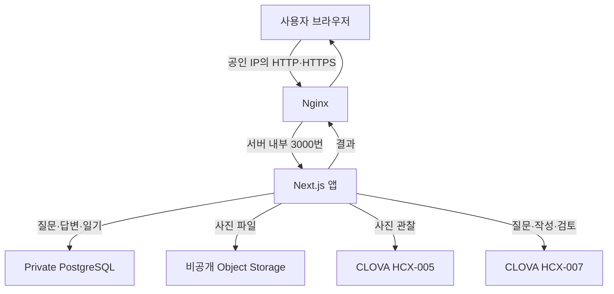

# 사진 너머 — 사진 한 장으로 시작해 기록을 남기기까지

사진 너머는 사진을 고르고 그날의 일을 질문에 답하면 일기 초안으로 정리해 주는 웹앱입니다. 사진만으로 알 수 없는 사정은 직접 이야기하고, 완성된 글도 본인이 읽고 고친 뒤 저장합니다.

이 README는 내 PC에서 앱을 켜고 기록 한 편을 저장한 다음 NCP 서버에 올리는 순서로 읽는 안내서입니다. 각 단계에서 어느 창을 사용하고, 무엇을 입력하고, 어떤 결과를 확인할지 설명합니다. 처음에는 클라우드 계정이나 API 키 없이 시작합니다.

코드를 공부하려는 경우에는 앱을 한 번 사용한 뒤 [코드 따라 읽기](docs/code/README.md)로 이어 가세요. 화면과 요청, 서버와 저장, 사진과 AI를 각각 나누어 설명했습니다. 이 README에서는 설치와 실제 사용을 이어 가겠습니다.

## 어디서 시작하면 될까요?

| 현재 상황 | 따라갈 순서 | 확인할 결과 |
|---|---|---|
| 처음 내려받아 써 보고 싶음 | [1장: PC에서 실행](#1-내-pc에서-앱을-켜기) → [2장: 기록 저장](#2-사진을-고르고-기록-한-편-저장하기) | 다시 열 수 있는 테스트 기록 한 편 |
| 내 PC 밖에서도 접속하고 싶음 | [3장: 실행 장소 이해](#3-내-pc에서-쓰던-앱을-서버로-옮기기-전에) → [4장: NCP 준비](#4-ncp에서-앱이-들어갈-자리-만들기) → [5장: 처음 배포](#5-ncp-서버에-처음-설치하고-공개하기) | PC를 꺼도 접속되는 앱 |
| 이미 NCP에서 운영 중임 | [6장: 기존 서버 업데이트](#6-운영-중인-ncp-서버를-새-버전으로-바꾸기) | 기존 설정을 보존한 새 버전 |
| 따라 하다가 막힘 | [7장: 마지막 성공 지점부터 확인](#7-막혔을-때-마지막으로-성공한-곳부터-확인하기) | 실패한 구간과 확인할 설정 |
| 현재 구현과 검증 범위가 궁금함 | [8장: 기능·검증·개발 이력](#8-현재-기능과-검증-범위-개발-이력) | 확인한 결과와 아직 남은 작업 |
| 코드를 읽거나 직접 요청해 보고 싶음 | [9장: 다음 실습](#9-설치를-마친-뒤-코드와-api-공부하기) | 코드·Postman 설명서로 연결 |

처음이라면 1~2장부터 차례로 진행합니다. 그다음 바로 NCP를 구축할 필요는 없습니다. 로컬 앱을 써 보고 코드를 먼저 읽어도 됩니다. 이미 운영 중인 서버를 업데이트하려면 6장에서 시작하되 안내한 서비스 이름과 폴더가 본인 서버의 구성과 같은지 확인하세요.

문서의 `203.0.113.10`은 설명에 사용하는 예약 주소입니다. 실제 서버로 연결되지 않으므로 NCP 명령에서는 본인의 공인 IP로 바꿉니다. 공개 저장소에는 실제 사용자 사진·일기·키·운영 접속 정보를 넣지 않았습니다.

## 1. 내 PC에서 앱을 켜기

이번 장의 목표는 내 PC에 앱을 내려받고 브라우저로 첫 화면을 여는 것입니다. 아직 NCP 콘솔이나 Ubuntu 서버를 준비할 필요는 없습니다. Windows의 PowerShell과 웹브라우저를 사용합니다.

### 1-1. 명령을 입력할 창 준비하기

Windows에서 시작 메뉴를 열어 PowerShell을 실행합니다. 다음과 비슷한 입력 표시가 있으면 내 PC에서 명령을 실행하는 창입니다.

```text
PS C:\workspace>
```

`PS ...>`는 PowerShell이 보여 주는 안내 표시입니다. 아래 명령을 복사할 때는 이 표시까지 입력하지 않습니다. 명령을 입력하고 Enter를 누르면 프로그램이 실행되고, 작업이 끝나면 보통 입력 표시가 다시 나타납니다.

이후 서버에 SSH로 접속하면 같은 창에 `root@...#`가 나타납니다. 그때부터는 내 PC가 아닌 서버에서 명령이 실행됩니다. 각 명령 앞에 적힌 실행 장소를 확인하는 습관을 들이면 Windows 명령을 Ubuntu에 입력하는 일을 줄일 수 있습니다.

### 1-2. Node.js와 Git이 있는지 확인하기

앱을 실행하려면 Node.js가 필요합니다. Node.js는 JavaScript로 작성한 서버 코드를 실행하는 프로그램이고, 함께 설치되는 npm은 앱에 필요한 라이브러리를 준비합니다. Git은 GitHub에서 코드를 내려받고 변경 이력을 관리할 때 사용합니다.

**내 PC의 PowerShell**에서 다음 세 줄을 한 줄씩 실행합니다.

```powershell
node -v
npm.cmd -v
git --version
```

각 줄에 버전 숫자가 나오면 해당 도구를 사용할 수 있습니다. 이 프로젝트의 최소 Node.js 버전은 `22.13.0`이며, 이 안내의 로컬·서버 설치 예시는 Node.js 24를 기준으로 합니다. `npm.cmd`는 Windows에서 npm 명령 파일을 직접 지정한 표기입니다.

`명령을 찾을 수 없다`는 오류가 나오면 먼저 도구를 설치합니다.

1. [Node.js 공식 다운로드](https://nodejs.org/en/download)에서 Windows용 Node.js 24 설치 파일을 받습니다.
2. 설치 파일을 실행하고 npm과 실행 경로를 추가하는 기본 선택을 유지합니다.
3. [Git 공식 Windows 설치 안내](https://git-scm.com/install/windows)에서 Git 설치 파일을 받아 설치합니다.
4. PowerShell을 닫았다가 새로 열어 위의 버전 명령을 다시 확인합니다.

여기서 설치하는 것은 Node.js와 Git이라는 도구입니다. 잠시 뒤 실행할 `npm ci`는 이 프로젝트가 쓰는 라이브러리를 설치하므로 별도로 필요합니다. 세 도구의 버전이 확인되면 코드를 받을 준비가 된 것입니다.

### 1-3. 코드를 내려받고 작업 폴더 확인하기

파일을 내려받을 위치부터 정하겠습니다. 이 문서의 PC 실습은 `Documents\projects` 안에 프로젝트를 두는 경로를 사용합니다. **내 PC의 PowerShell**에서 실행합니다.

```powershell
New-Item -ItemType Directory -Force "$env:USERPROFILE\Documents\projects"
Set-Location "$env:USERPROFILE\Documents\projects"
git clone https://github.com/tw-kang01/2026-NCP-Above-Picture.git
Set-Location .\2026-NCP-Above-Picture
Get-ChildItem package.json
```

첫 줄은 작업 폴더를 만들고, `Set-Location`은 명령이 실행될 현재 폴더를 바꿉니다. `git clone`은 공개 저장소의 파일과 변경 이력을 새 프로젝트 폴더에 내려받습니다. 마지막 줄에서 `package.json`이 보이면 프로젝트 최상위 폴더까지 들어온 것입니다.

이미 내려받은 폴더가 있다면 clone을 다시 하지 말고 그 폴더로 이동합니다. `destination path ... already exists`가 나오면 폴더가 이미 있다는 뜻입니다. 기존 폴더를 지우기 전에 그 안에 자신의 수정이나 데이터가 있는지 확인하세요.

이후 PC 명령은 별도 안내가 없으면 `package.json`이 있는 이 폴더에서 실행합니다. 나중에 새 PowerShell을 열었을 때도 먼저 다음 명령으로 돌아옵니다.

```powershell
Set-Location "$env:USERPROFILE\Documents\projects\2026-NCP-Above-Picture"
```

### 1-4. 필요한 라이브러리 설치하기

**프로젝트 폴더의 PowerShell**에서 설치 명령을 실행합니다.

```powershell
npm.cmd ci
```

`package.json`에는 필요한 라이브러리와 실행 명령이, `package-lock.json`에는 실제 설치할 구성이 기록되어 있습니다. `npm ci`는 이 잠금 파일을 기준으로 `node_modules` 폴더에 라이브러리를 설치합니다. 다운로드가 끝나고 입력 표시가 돌아올 때까지 기다립니다.

오류 없이 끝나면 다음 단계로 갑니다. `package.json`을 찾을 수 없다는 오류라면 현재 폴더를, 다운로드 연결 오류라면 인터넷 연결을 확인합니다. 설치 중에 나온 오류를 그대로 둔 채 실행 명령으로 넘어가지는 않습니다. 이 설치는 처음 시작하거나 의존성이 바뀌었을 때 필요하며 앱을 켤 때마다 반복하지 않아도 됩니다.

### 1-5. 서버를 켜고 브라우저에서 열기

같은 PowerShell에서 개발 서버를 켭니다.

```powershell
npm.cmd run dev
```

`Ready`가 나오면 웹브라우저 주소창에 다음 주소를 입력합니다. 이 주소는 PowerShell에 입력하는 명령이 아닙니다.

```text
http://127.0.0.1:3000
```

앱 첫 화면이 열리면 성공입니다. `127.0.0.1`은 지금 브라우저를 쓰는 내 PC이고, `3000`은 앱이 요청을 받는 번호입니다. 이때 PowerShell의 서버는 계속 실행 중이므로 입력 표시가 돌아오지 않아도 정상입니다. 그 창을 열어 둔 채 브라우저에서 앱을 사용합니다.

첫 화면이 열리지 않으면 PowerShell에 `Ready`가 있는지 봅니다. 3000번이 이미 사용 중이라는 오류가 나오면 이전에 켠 앱을 확인하고 해당 창에서 `Ctrl+C`로 종료합니다. 주소를 임의로 바꾸기 전에 실제로 어느 포트에서 서버가 켜졌는지 확인하세요.

기본 설정은 `demo`입니다. 이 모드에서는 준비된 질문과 직접 입력한 답변으로 기능을 체험하며 외부 AI를 호출하지 않습니다. 예전에 만든 `.env.local`이 있는 폴더에서는 그 파일의 `APP_MODE`가 적용될 수 있으므로 체험 모드 표시를 확인합니다.

이제 앱이 켜졌습니다. 서버 창은 그대로 두고 다음 장에서 사진 한 장으로 기록을 남겨 보겠습니다.

## 2. 사진을 고르고 기록 한 편 저장하기

이번에는 화면을 한 번 끝까지 사용합니다. 실습에서는 '발표를 마치고 동네 카페에서 쉬었다'라는 가상의 기억을 예로 들겠습니다. 아래 문장은 기능을 설명하기 위해 만든 예시이며 실제 사용자의 기록이 아닙니다. 직접 만든 다른 테스트 상황을 써도 됩니다.

사진도 공개해도 되는 테스트 이미지를 고릅니다. 프로젝트의 `scripts/fixtures/test-photo.png`를 사용할 수 있습니다. demo는 사진 내용을 분석하지 않으므로 이 이미지가 카페 사진일 필요는 없습니다.

### 2-1. 날짜와 사진을 준비하기

브라우저에서 **새 기억 남기기**를 누릅니다. 기억의 날짜를 고르고 장소에는 `동네 카페`처럼 실습용 문구를 입력합니다. 장소를 모르면 비워 둘 수 있습니다. 질문 수는 처음에는 기본값인 3개를 사용하겠습니다.

사진 한 장을 고르면 화면에 미리보기가 보여야 합니다. 사진은 JPG·PNG·WebP를 1~3장 선택할 수 있습니다. 사진을 누르면 확대해서 볼 수 있고, 여러 장이면 좌우로 넘깁니다. 확대창은 닫기 버튼이나 `Esc`로 닫습니다.

미리보기와 입력값을 확인한 뒤 **기억 꺼내기 시작**을 누릅니다. 이때 기록 생성, 사진 업로드, 첫 질문 준비가 순서대로 이루어집니다. 사진을 골랐다는 것과 서버에 업로드했다는 것은 다른 시점입니다. 선택 직후의 미리보기는 내 PC에서 준비한 사진이고, 시작 요청이 성공하면 서버에도 사진이 남습니다.

첫 질문과 답변 입력창이 나오면 이 단계를 마친 것입니다. 실패 안내가 나오면 사진 형식·크기를 먼저 확인하고 화면에 남은 안내를 읽습니다. 시작을 연속으로 누르기보다 어느 단계에서 멈췄는지 확인하세요.

### 2-2. 질문에 답하고 다음 질문 보기

첫 질문에 맞춰 가상의 상황을 한두 문장으로 적습니다. 예를 들어 다음처럼 답할 수 있습니다.

> 발표가 끝나서 친구와 쉬고 있었어요. 준비하면서 힘들었던 부분을 이야기했어요.

**답변 보내기**를 누르고 기다립니다. 성공하면 방금 보낸 답변이 이전 대화에 남고 다음 질문이 나타납니다. demo 질문은 사진 분석 결과가 아니므로 사진 속 장면을 실제로 이해했다고 판단하지 않습니다.

새 질문에는 앞에서 말하지 않은 내용을 조금 더 적어 봅니다. 사진에 보이지 않는 일도 답변으로 설명할 수 있습니다. 실제 NCP 모드에서도 사용자가 말한 내용이 일기 작성의 근거가 됩니다. 사진 속 인물의 관계나 그날 감정을 AI가 추측해서 채우도록 만들지 않았습니다.

질문은 건너뛸 수 있으며 처음 선택한 수를 모두 채우기 전에 마무리할 수도 있습니다. 다만 실제 답변이 하나는 있어야 초안을 만듭니다. 첫 답변을 보낸 뒤에는 **여기까지의 답변으로 기록 만들기**를 쓸 수 있고, 모든 질문을 마치면 **나의 기록 만들기**로 이어집니다. 입력창에 아직 보내지 않은 글이 있다면 먼저 보내거나 정리합니다.

### 2-3. 초안을 읽고 원래 답변과 비교하기

초안을 만들면 제목과 본문을 편집할 수 있는 화면이 나옵니다. 질문과 답변 원문도 펼쳐 보세요. 앞에서 입력한 '발표가 끝났다', '친구와 쉬었다', '준비하면서 힘들었던 부분을 이야기했다'가 어떻게 남았는지 비교합니다.

demo는 외부 AI가 쓴 글이 아닙니다. 이 단계에서는 정리 화면과 저장 흐름을 익힙니다. `ncloud`에서 실제 AI를 연결한 뒤에도 같은 방식으로 빠진 사실이나 잘못 덧붙인 내용을 직접 확인해야 합니다.

제목을 `발표 뒤의 휴식`처럼 바꾸고 본문도 원하는 문장으로 고칩니다. 초안 자체는 서버에 생성되어 있지만 입력창에서 새로 고친 내용은 아직 저장되지 않았습니다. 이 구분을 확인하려고 다음 단계에서 저장 후 다시 열어 보겠습니다.

저장 전에는 **답변으로 초안 다시 만들기**도 사용할 수 있습니다. 현재 제목·본문을 새 초안으로 교체하므로 직접 쓴 문장을 남기려면 먼저 따로 보관합니다. 이미 저장한 기록은 이 버튼으로 자동 재작성하지 않으며 직접 편집할 수 있습니다.

### 2-4. 저장하고 다시 열어 확인하기

**기록 저장하기**를 누릅니다. 성공 안내를 확인한 뒤 목록으로 돌아가 방금 만든 기록을 다시 엽니다. 고친 제목과 본문, 사진, 질문·답변 원문이 보이면 한 번의 사용 흐름을 끝까지 마친 것입니다.

같은 브라우저에서 새로고침해도 기록을 다시 읽을 수 있어야 합니다. 다른 브라우저나 시크릿 창에서는 같은 기록이 보이지 않을 수 있습니다. 현재 앱은 회원가입 대신 브라우저 쿠키로 사용자를 구분하므로 실습을 이어 갈 때도 같은 브라우저와 주소를 사용합니다. 원리는 별도의 [저장·쿠키 설명](docs/code/02-server-and-storage.md#2-6-로그인-없이-내-기록을-구분하기)에서 읽을 수 있습니다.

여기까지만 앱을 체험하고 마쳐도 됩니다. **내 PC의 서버를 종료할 때**는 `npm.cmd run dev`를 실행한 PowerShell에서 `Ctrl+C`를 누릅니다. 브라우저만 닫으면 서버는 계속 실행되고, PC를 끄면 함께 멈춥니다. 다시 사용할 때는 프로젝트 폴더에서 개발 서버를 켭니다.

코드가 궁금하다면 개발 서버를 켜 둔 채 [화면과 요청 따라 읽기](docs/code/01-browser-and-request.md)로 이어 갈 수 있습니다. 다른 기기에서도 앱을 열고 싶다면 다음 장에서 실행 장소가 어떻게 달라지는지 먼저 살펴보겠습니다.

## 3. 내 PC에서 쓰던 앱을 서버로 옮기기 전에

지금까지는 내 PC가 앱을 실행했습니다. 브라우저를 닫아도 PowerShell의 개발 서버는 계속 켜져 있지만 PC를 끄면 실행이 끝납니다. 다른 사람이 언제든 접속하도록 하려면 앱을 계속 실행할 컴퓨터가 필요합니다. 이 프로젝트에서는 NCP의 Ubuntu 서버로 그 일을 옮깁니다.

### 3-1. 같은 주소를 다른 기기에 입력하면 왜 열리지 않을까요?

1장에서 연 `http://127.0.0.1:3000`을 세 부분으로 읽어 보겠습니다. `http`는 웹 통신 방식, `127.0.0.1`은 요청하는 컴퓨터 자신, `3000`은 그 컴퓨터 안에서 앱이 요청을 받는 포트 번호입니다.

내 PC 브라우저에서 이 주소를 열면 내 PC의 앱으로 갑니다. 휴대폰에 같은 주소를 넣으면 휴대폰 자신의 3000번을 찾으므로 내 PC 앱으로 연결되지 않습니다. NCP 서버의 터미널에서 `127.0.0.1`을 쓰면 이번에는 NCP 서버 자신을 가리킵니다. 주소 글자가 같아도 요청하는 기기가 다르면 목적지도 달라집니다.

다른 기기에서 서버에 접속하려면 인터넷에서 찾아갈 수 있는 공인 IP가 필요합니다. 서버와 DB처럼 클라우드 내부에서 연결할 자원에는 사설 IP를 사용합니다. 다음 장에서는 웹 요청을 받을 앱 서버와 내부에서만 연결할 DB의 자리를 따로 만들겠습니다.

도메인은 IP 대신 사람이 읽기 쉬운 이름을 사용하는 방법이고 DNS는 그 이름에 연결된 주소를 찾는 체계입니다. 도메인 구매·DNS 등록·앱 실행은 서로 다른 작업입니다. 이 프로젝트의 배포 절차는 도메인을 준비하지 않아도 공인 IP로 진행할 수 있게 구성했습니다.

### 3-2. 서버로 옮긴 뒤의 요청 경로

브라우저는 화면을 그리고 입력을 받는 클라이언트이며 서버는 그 요청을 검사하고 처리합니다. 로컬에서는 둘 다 내 PC에서 실행됐지만 NCP에 올리면 브라우저와 서버가 서로 다른 컴퓨터에 있을 수 있습니다.



Nginx는 외부의 80번 HTTP·443번 HTTPS 요청을 받아 서버 내부 앱으로 전달합니다. 앱이 듣는 3000번과 DB의 5432번을 인터넷에 직접 공개할 필요는 없습니다. 브라우저가 DB 암호나 CLOVA 키를 받아 외부 서비스에 직접 접속하는 방식도 아닙니다. 비밀 설정과 실제 외부 요청은 서버가 관리합니다.

HTTP는 웹의 요청·응답 약속이고 HTTPS는 TLS로 통신을 암호화하고 인증서를 확인하는 방식입니다. 주소의 `http`를 `https`로 바꾸기만 해서는 연결되지 않습니다. 5장에서 HTTP 응답을 먼저 확인한 뒤 인증서와 443번 수신을 함께 설정하겠습니다.

### 3-3. 실행 모드를 바꿀 때 저장 위치도 바뀝니다

`demo`는 준비된 질문을 쓰고 기록·사진을 로컬 데이터 폴더에 저장합니다. `ncloud`는 실제 AI를 호출하고 기록은 PostgreSQL, 사진은 Object Storage에 저장합니다. NCP 연결 정보를 채우는 것과 예전 demo 데이터를 옮기는 것은 별도 작업이며 자동 이전 기능은 없습니다.

현재 앱은 회원가입 대신 브라우저의 익명 쿠키로 내 기록을 구분합니다. 같은 PC라도 브라우저·시크릿 창·접속 호스트가 달라지면 기존 기록이 보이지 않을 수 있습니다. 쿠키를 지웠을 때 계정으로 복구하거나 기기끼리 동기화하는 기능은 없습니다. 업데이트 뒤 기록을 확인할 때도 같은 호스트와 브라우저를 사용해야 합니다.

공개 코드에 개인 기록이 없더라도 실제 운영 앱은 사진과 답변을 저장하며 AI 처리에 사용할 수 있습니다. 처음에는 공개해도 되는 테스트 이미지와 가상 문장으로 전체 경로를 확인하세요. 저장·쿠키·AI 내부 처리가 궁금하다면 [코드 설명서](docs/code/README.md)에서 이어 읽을 수 있습니다.

이제 실행 장소와 저장 위치를 구분했습니다. 다음 장에서는 그림 속 자원을 하나씩 만들고, 그 결과를 서버 설정에 넣는 값으로 연결하겠습니다.

## 4. NCP에서 앱이 들어갈 자리 만들기

앞에서 본 배치를 만들기 위해 NCP 콘솔에서 네트워크·앱 서버·사진 저장소·DB·AI 권한을 준비하겠습니다. 이 안내는 한국 리전의 VPC 플랫폼과 Ubuntu 서버를 기준으로 합니다. 한 자원을 만든 뒤 그 결과를 다음 단계에서 어떻게 사용하는지 연결해서 설명합니다.

이 장의 작업 장소는 대부분 **웹브라우저의 NCP 콘솔**입니다. PowerShell이나 Ubuntu 터미널에 서비스 이름을 입력하는 작업이 아닙니다. 자원을 만들 때는 콘솔에 표시되는 이용 조건과 요금을 확인하세요. 이 README는 자원을 대신 생성하거나 유료 API를 자동으로 호출하지 않습니다.

완성할 배치는 아래와 같습니다. 이름과 주소 범위는 설명용 예시입니다.

```text
인터넷의 브라우저
        │ 공인 IP의 80 또는 443번
        ▼
VPC 10.20.0.0/16
├─ Public Subnet 10.20.1.0/24
│   └─ Ubuntu 앱 서버: Nginx → Next.js
└─ Private Subnet 10.20.2.0/24
    └─ PostgreSQL: 질문·답변·일기

앱 서버 ── HTTPS ── Object Storage: 비공개 사진
앱 서버 ── HTTPS ── CLOVA Studio: 사진 관찰·질문·일기
```

문서의 `203.0.113.10`은 실제 서버가 없는 설명용 공인 IP입니다. 이후 SSH·scp·설치 명령에서는 NCP 콘솔에서 확인한 **본인 서버의 실제 공인 IP**로 바꿉니다. VPC의 `10.20...` 범위는 네트워크 구성 예시이고 서버 접속에 쓰는 공인 IP와는 역할이 다릅니다.

### 4-1. CLOVA Studio에서 두 모델을 쓸 수 있는지 확인하기

앱은 사진을 살펴보는 작업과 문장을 쓰는 작업에 다른 모델을 사용합니다. 사진 관찰에는 HCX-005를, 질문 생성·일기 작성·검토에는 HCX-007을 사용합니다. 한 모델을 사용한 적이 있어도 다른 모델의 이용 권한까지 준비됐다고 볼 수는 없습니다.

**작업 장소: CLOVA Studio 관리 화면.** 계정에서 API 이용을 준비하고 두 모델에 대한 사용 권한을 각각 확인합니다. 앱이 사용할 API 키도 발급받아 보관합니다. 이 키는 뒤에서 서버의 `CLOVA_STUDIO_API_KEY`에 입력할 값입니다.

이 단계의 결과는 두 모델의 이용 가능 여부와 서버에 입력할 키입니다. 플레이그라운드에서 답변이 나온다는 것과 앱에서 API 요청이 성공한다는 것은 확인 경로가 다릅니다. 실제 앱의 모델 이름과 추론 설정은 `src/lib/server/clova-models.js`가 정하며 플레이그라운드에서 바꾼 값이 이 파일에 자동으로 저장되지는 않습니다.

키 앞에 `Bearer`라는 단어를 직접 붙이지 않습니다. 앱이 요청 헤더를 만들 때 처리합니다. 키는 이 README나 GitHub 파일에 적지 말고 서버 설정을 작성할 때만 사용하세요.

아직 실제 모델 요청을 보내지 않아도 다음 네트워크 준비를 진행할 수 있습니다. 요청 성공 여부는 서버의 설정을 채운 뒤 별도 단계에서 확인하겠습니다.

### 4-2. VPC와 두 Subnet으로 서버와 DB의 자리를 나누기

VPC는 이 프로젝트의 서버와 DB가 통신할 사설 네트워크입니다. Subnet은 그 네트워크 안에서 주소 구간을 나눈 것입니다. 앱 서버는 인터넷 요청을 받아야 하므로 Public Subnet에 두고 DB는 앱 서버가 내부에서 접근하도록 Private Subnet에 둡니다.

**작업 장소: NCP 콘솔의 VPC·Subnet 화면.** 다음 예처럼 VPC 하나와 Subnet 두 개를 준비합니다. 기존 네트워크를 사용한다면 다른 자원과 주소가 겹치지 않는지 먼저 확인합니다.

| 만들 대상 | 예시 이름 | 예시 주소 범위 | 사용할 곳 |
|---|---|---|---|
| VPC | `memory-vpc` | `10.20.0.0/16` | 앱과 DB를 함께 둘 네트워크 |
| Public Subnet | `memory-app-public` | `10.20.1.0/24` | Ubuntu 앱 서버 |
| Private Subnet | `memory-db-private` | `10.20.2.0/24` | PostgreSQL |

주소 뒤의 `/16`, `/24`는 CIDR 표기입니다. 주소의 앞쪽 몇 비트를 네트워크 구분에 쓰는지 나타내며 예시의 두 `/24` 구간은 `/16` VPC 안에 들어갑니다. `/32`는 IPv4 주소 하나를 가리키므로 뒤에서 내 PC 한 곳만 SSH로 허용할 때 사용합니다.

처음 구성한다면 앱과 DB를 같은 가용 Zone에 맞추고 Public Subnet의 인터넷 경로와 Network ACL을 확인합니다. Public이라는 이름만 보고 모든 통신이 가능하다고 판단하지 않습니다. 공인 IP·라우팅·접근 허용 규칙이 함께 맞아야 인터넷에서 앱에 도달합니다.

앱 서버와 같은 VPC의 DB가 내부 주소로 통신하는 경로 자체에는 NAT Gateway가 필요하지 않습니다. 반면 앱 서버가 패키지를 내려받거나 CLOVA Studio에 요청할 때는 인터넷으로 나가는 경로가 필요합니다.

다음 단계에서 사용할 결과는 VPC, 앱용 Public Subnet, DB용 Private Subnet입니다. 각각 어느 자원에 연결할 것인지 이름을 구분해 두세요.

### 4-3. ACG로 들어오는 연결과 나가는 연결 허용하기

IP 주소가 목적지를 알려 준다면 ACG는 그 목적지로 어떤 통신을 허용할지 정합니다. Inbound는 서버로 들어오는 연결이고 Outbound는 서버에서 나가는 연결입니다. 브라우저가 앱을 여는 연결과 앱이 AI에 요청하는 연결은 방향이 다릅니다.

**작업 장소: NCP 콘솔의 앱 서버용 ACG.** 먼저 앱 서버에 연결할 ACG를 만들고 다음 용도의 규칙을 준비합니다. 콘솔에서 규칙을 작성한 뒤 실제로 적용됐는지도 확인합니다.

| 방향 | 프로토콜 | 출발지 또는 목적지 | 포트 | 이 단계에서 필요한 이유 |
|---|---|---|---|---|
| Inbound | TCP | 내 PC의 실제 공인 IP `/32` | 22 | 관리자가 SSH로 접속 |
| Inbound | TCP | `0.0.0.0/0` | 80 | HTTP 접속·인증서 확인 |
| Inbound | TCP | `0.0.0.0/0` | 443 | HTTPS 접속 |
| Outbound | TCP | `0.0.0.0/0` | 80 | 설치 파일·패키지 다운로드 |
| Outbound | TCP | `0.0.0.0/0` | 443 | CLOVA·Storage·HTTPS 다운로드 |
| Outbound | UDP와 TCP | 환경에 맞는 DNS 목적지 | 53 | 서버 이름을 IP로 조회 |
| Outbound | UDP | 환경에 맞는 시간 서버 | 123 | 서버 시각 동기화 |
| Outbound | TCP | 실제 DB 내부 대역 | 5432 | 앱에서 PostgreSQL 접속 |

`0.0.0.0/0`은 IPv4의 모든 주소를 뜻합니다. 공개 웹사이트의 80·443에는 여러 이용자가 접속해야 하므로 이 범위를 쓰지만 관리자 접속용 22는 내 PC의 실제 공인 IP로 제한합니다. PC의 Wi-Fi를 바꾸면 공인 IP도 바뀔 수 있어 기존 SSH 허용 범위를 다시 확인해야 합니다.

앱의 3000번 포트는 공개하지 않습니다. 뒤에서 Nginx가 80·443으로 요청을 받아 서버 내부의 앱 3000번으로 전달합니다. DB의 5432도 인터넷 전체에 공개하지 않습니다. DB 접근은 앱 서버와 DB 사이에서 별도로 허용하겠습니다.

DNS와 시간 서버의 목적지는 실제 운영 환경의 정책에 맞춥니다. SSH는 되는데 `apt-get`, `npm ci`, AI 요청이 시간 초과라면 Inbound만 보지 말고 Outbound와 인터넷 경로도 확인하세요.

이 단계가 끝나면 앱 서버에 붙일 ACG와 허용한 통신 목적을 설명할 수 있어야 합니다. [NCP ACG 공식 안내](https://guide.ncloud-docs.com/docs/server-acg-vpc)에서 규칙 설정 방법을 확인할 수 있습니다.

### 4-4. Ubuntu 서버와 공인 IP 준비하기

**작업 장소: NCP 콘솔의 Server 화면.** 앱용 Public Subnet에 Ubuntu 서버를 만들고 앞에서 준비한 앱 ACG를 연결합니다. 인터넷에서 접속할 공인 IP도 앱 서버에 연결합니다.

이 서버의 사설 IP와 공인 IP를 구분해 보관하세요. 공인 IP는 PC의 SSH·scp와 브라우저 접속에 사용합니다. 사설 IP는 뒤에서 DB 사용자의 접근을 허용할 때 사용합니다. 두 칸에 같은 주소를 무조건 넣는 방식으로 진행하지 않습니다.

관리자 인증에 필요한 인증키와 접속 정보도 해당 계정의 안내대로 준비합니다. 이 문서의 명령은 root 계정으로 설치하는 구성을 기준으로 합니다. 조직에서 별도 관리자 계정을 사용한다면 관리자 권한과 경로가 달라질 수 있습니다.

정상적인 준비 결과는 서버가 운영 중이고 Public Subnet·앱 ACG·공인 IP가 의도한 서버에 연결된 상태입니다. 공인 IP를 적어 두었더라도 서버가 중지돼 있거나 ACG가 다른 서버에 연결돼 있으면 SSH에 실패합니다.

다음 장에서 바로 SSH로 접속하므로 서버 관리자 인증 정보와 실제 공인 IP를 준비해 두세요. 개인 인증키 파일은 GitHub나 업데이트 ZIP에 넣지 않습니다.

### 4-5. 사진을 보관할 비공개 Object Storage 만들기

사진 파일은 DB에 그대로 넣지 않고 Object Storage에 보관합니다. DB에는 그 사진이 어느 기록에 속하고 저장소의 어떤 키로 찾아야 하는지 남깁니다. 파일 자체와 파일의 설명 정보를 나눠 관리하는 구조입니다.

**작업 장소: NCP 콘솔의 Object Storage·계정 권한 관리 화면.** 비공개 버킷을 만들고 앱이 그 저장소를 사용할 권한을 준비합니다. 별도 서브 계정으로 접근 키를 관리한다면 그 계정에 필요한 저장소 권한도 부여합니다.

현재 코드는 한국 리전의 `kr.object.ncloudstorage.com`과 `kr-standard`를 사용하므로 이 구성에 맞는 버킷을 준비합니다. 다른 리전을 사용하려면 키·버킷 이름뿐 아니라 `src/lib/server/object-storage.js`의 연결 설정도 맞춰야 합니다.

키 발급과 권한 부여는 다른 일입니다. Access Key와 Secret Key가 있어도 해당 버킷을 읽거나 쓸 권한이 없으면 업로드가 실패합니다. 연결을 시험하려고 넓은 권한을 사용했다면 운영 전에 필요한 버킷과 행동으로 좁힐 수 있는지 검토합니다.

이 단계에서 서버 설정에 넣을 값은 다음 세 가지입니다.

| 서버 설정 이름 | 여기서 준비할 값 |
|---|---|
| `NCP_ACCESS_KEY` | 저장소 요청에 사용할 Access Key |
| `NCP_SECRET_KEY` | 해당 키의 Secret Key |
| `NCP_BUCKET` | 앱의 비공개 사진 버킷 이름 |

버킷을 정적 웹사이트용으로 전체 공개하지 않습니다. 앱은 필요할 때만 짧게 유효한 서명 URL을 만들며 현재 코드의 사진 관찰용 URL은 300초 동안 유효합니다. 공개 사진 주소를 모든 이용자가 계속 공유하는 구조로 바꾸지 않아도 AI가 사진을 읽을 수 있습니다.

버킷 이름과 키를 서버 설정에 입력할 수 있으면 다음 DB 단계로 넘어갑니다. 사진 업로드 성공 여부는 앱을 실행한 뒤 실제 테스트 사진으로 확인합니다. [Object Storage 공식 안내](https://guide.ncloud-docs.com/docs/storage-storage-6-1/)도 참고할 수 있습니다.

### 4-6. PostgreSQL을 만들고 앱 서버만 접근하게 하기

PostgreSQL은 질문·답변·초안·완성 일기와 사진 연결 정보를 보관합니다. `ncloud` 모드의 앱은 같은 DB와 버킷을 계속 사용하므로 코드만 새로 배포해도 기존 기록을 이어서 읽을 수 있습니다.

**작업 장소: NCP 콘솔의 Cloud DB for PostgreSQL 화면.** 앞에서 준비한 Private Subnet에 DB를 만듭니다. 사양·고가용성·백업 옵션은 필요한 조건과 요금을 확인해 선택합니다.

DB의 실제 내부 호스트 주소, 포트, DB 이름, 사용자, 비밀번호를 준비합니다. 예시의 `memorydb`, `memoryapp`은 직접 정하는 이름이며 이미 만든 자원이 있다면 그 실제 이름에 맞춥니다.

| 서버 설정 이름 | 넣을 값 |
|---|---|
| `PGHOST` | DB의 실제 Private 호스트 주소 |
| `PGPORT` | DB 접속 포트, 이 구성의 기본값 `5432` |
| `PGDATABASE` | 앱이 사용할 DB 이름 |
| `PGUSER` | 앱의 DB 사용자 이름 |
| `PGPASSWORD` | 해당 DB 사용자의 비밀번호 |

여기에는 두 종류의 접근 허용이 필요합니다. DB ACG의 Inbound는 앱 서버 ACG에서 오는 TCP 5432를 허용하고 DB 사용자 접근 제어에는 앱 서버의 **실제 사설 IP `/32`**를 지정합니다. 서버의 공인 IP나 PC의 공인 IP를 넣는 단계가 아닙니다.

앱이 처음 사용할 때 테이블과 인덱스를 만들 수 있는 DB 권한도 필요합니다. 네트워크가 연결돼도 DB 이름·사용자·암호·권한이 다르면 앱이 기록을 저장하지 못합니다.

정상 준비 결과는 Private DB가 운영 중이고 앱 서버가 네트워크 규칙과 DB 사용자 규칙 모두에서 허용된 상태입니다. 실제 연결 성공은 다음 장에서 앱을 실행해 확인합니다. [PostgreSQL 공식 안내](https://guide.ncloud-docs.com/docs/clouddbforpostgresql-overview)에서 해당 서비스의 구성 방법을 볼 수 있습니다.

### 4-7. 다음 장에 가져갈 값을 구분하기

이제 서버·저장소·DB·AI를 준비했습니다. 서버에 코드를 설치하기 전에 인증 정보가 서로 섞이지 않았는지 확인하겠습니다. 모두 비밀번호처럼 보여도 사용하는 곳이 다릅니다.

| 인증 정보 | 사용하는 일 | 다음 장에서 다룰 위치 |
|---|---|---|
| 서버 관리자 인증 | SSH 접속·scp 전송 | 접속할 때 입력하거나 인증키 사용 |
| DB 사용자와 비밀번호 | PostgreSQL 접속 | `PGUSER`, `PGPASSWORD` |
| NCP Access Key·Secret Key | Object Storage 요청 서명 | `NCP_ACCESS_KEY`, `NCP_SECRET_KEY` |
| CLOVA Studio API 키 | HCX-005·HCX-007 요청 | `CLOVA_STUDIO_API_KEY` |

서버 root 암호를 DB 암호 칸에 넣거나 스토리지 Secret Key를 CLOVA 키 칸에 넣으면 연결되지 않습니다. 실제 값은 비공개로 보관하고 문서·화면 캡처·채팅에 적지 않습니다.

다음 장은 **서버에 이 앱을 처음 설치하는 경우**입니다. 이미 `photo-memory` 서비스가 실행 중이라면 새 설치를 반복하지 말고 [6장](#6-운영-중인-ncp-서버를-새-버전으로-바꾸기)의 업데이트 순서를 따르세요.

## 5. NCP 서버에 처음 설치하고 공개하기

이 장에서는 새 Ubuntu 서버에 Node와 코드를 설치하고 환경 설정을 채운 뒤 자동 실행을 등록합니다. 모든 과정이 끝나면 내 PC의 개발 서버나 SSH 터널 없이 실제 공인 주소로 앱을 열게 됩니다.

앞 장의 자원이 준비돼 있어야 합니다. 진행 중 명령이 실패하면 다음 블록으로 넘어가지 말고 그 단계의 확인 항목을 먼저 보세요. 설치 파일을 받는 단계, 코드를 빌드하는 단계, 실제 클라우드 연결을 확인하는 단계의 성공 여부는 따로 판단하겠습니다.

### 5-1. PC에서 서버로 접속하기

**실행 장소: 내 PC의 PowerShell.** 예시 IP를 실제 공인 IP로 바꿔 아래 명령을 실행합니다.

```powershell
ssh root@203.0.113.10
```

`ssh`는 서버에 암호화된 관리 연결을 여는 명령입니다. 첫 접속이면 서버의 호스트 키를 신뢰할지 물을 수 있으므로 접속하려는 서버가 맞는지 확인합니다. `password:`가 나오면 서버 관리자 인증을 입력합니다. 입력 중 글자나 별표가 표시되지 않는 경우도 있습니다.

정상적으로 접속하면 입력 표시가 `PS ...>`에서 `root@...:~#` 같은 형태로 바뀝니다. 지금부터 그 창에 입력한 명령은 내 PC가 아닌 Ubuntu 서버에서 실행됩니다. IP나 인증 오류가 아니라 연결 시간 초과라면 서버 운영 상태·공인 IP 연결·앱 ACG의 22번과 PC 공인 IP부터 확인합니다.

### 5-2. 서버의 기본 도구와 Node 24 준비하기

**실행 장소: SSH로 접속한 Ubuntu 서버.** 먼저 설치에 필요한 도구를 준비합니다.

```bash
apt-get update
apt-get install -y curl ca-certificates git unzip nano
```

첫 줄은 패키지 목록을 갱신하고 다음 줄은 다운로드·인증서·Git·ZIP 해제·텍스트 편집 도구를 설치합니다. 설치가 끝나 입력 표시가 돌아오면 다음으로 넘어갑니다. 다운로드가 시간 초과라면 앱 ACG Outbound, DNS, Public Subnet의 인터넷 경로를 확인합니다.

아래는 기존 안내와 같은 nvm 설치 방법입니다. nvm은 같은 계정에서 사용할 Node 버전을 설치하고 선택하는 도구입니다. 이미 요구 버전의 Node가 준비돼 있다면 버전만 확인하고 중복 설치를 건너뛸 수 있습니다. 프로젝트의 최소 요구는 Node `22.13.0` 이상이며 이 안내는 Node 24를 기준으로 진행합니다.

```bash
curl -fsSL https://raw.githubusercontent.com/nvm-sh/nvm/v0.40.8/install.sh -o /tmp/photo-memory-nvm-install.sh
bash /tmp/photo-memory-nvm-install.sh
source /root/.nvm/nvm.sh
nvm install 24
nvm alias default 24
node -v
npm -v
```

첫 줄은 설치 도구를 파일로 내려받고 두 번째 줄은 그 파일을 실행합니다. `source`는 설치한 nvm을 현재 터미널에서 불러옵니다. `nvm install 24`는 Node 24와 npm을 설치하며 `alias default 24`는 이후 터미널의 기본 버전을 정합니다.

정상 결과는 `node -v`에서 `v24.`로 시작하는 숫자, `npm -v`에서 npm 버전이 나오는 것입니다. 다시 SSH 접속한 뒤 `node`를 찾지 못하면 `source /root/.nvm/nvm.sh`를 실행해 현재 터미널에서도 불러왔는지 확인합니다. 설치 출처와 방식은 [nvm 공식 안내](https://github.com/nvm-sh/nvm#installing-and-updating)에서 볼 수 있습니다.

Node 설치는 JavaScript 실행 도구를 준비하는 일입니다. 뒤에서 실행할 `npm ci`는 이 프로젝트가 쓰는 라이브러리를 준비하므로 Node 설치만 끝냈다고 생략할 수는 없습니다.

### 5-3. 서버에 공개 코드를 내려받기

**실행 장소: Ubuntu 서버.** 앱을 처음 설치하며 `/root/photo-memory-app`이 아직 없을 때 실행합니다.

```bash
git clone https://github.com/tw-kang01/2026-NCP-Above-Picture.git /root/photo-memory-app
cd /root/photo-memory-app
npm ci
```

`git clone`은 GitHub의 공개 코드를 지정한 폴더에 내려받습니다. `cd`는 이후 명령을 실행할 폴더를 바꾸고 `npm ci`는 잠금 파일에 기록된 라이브러리를 설치합니다. 설치가 오류 없이 끝나면 이 폴더에 `node_modules`가 생깁니다.

대상 폴더가 이미 있다는 오류가 나면 기존 파일을 지우고 재시도하지 않습니다. 이전 설치나 사용자 데이터가 있는지 먼저 확인하고 기존 운영 앱이라면 6장을 사용합니다. `npm ci`가 실패하면 Node 버전, 인터넷 Outbound, 실제 실행 위치에 `package.json`이 있는지 확인합니다.

이 폴더는 **코드를 준비하고 빌드하는 원본 작업 폴더**입니다. 뒤의 설치 도구는 여기에서 준비한 결과를 `/srv/photo-memory-app`으로 복사해 서비스를 실행합니다. 두 폴더가 같은 역할을 한다고 생각하면 업데이트 때 설정을 잘못 덮어쓸 수 있어 구분해 두겠습니다.

### 5-4. 서버에서만 실제 환경 설정 채우기

앱은 환경 변수로 실행 모드와 외부 서비스 접속 정보를 읽습니다. 공개 코드에는 실제 값이 없으므로 예시 파일을 복사한 뒤 서버 안에서 수정합니다.

**실행 장소: Ubuntu 서버의 `/root/photo-memory-app`.**

```bash
cp .env.example .env.local
chmod 600 .env.local
nano .env.local
```

`cp`는 새 설정 파일을 만들고 `chmod 600`은 파일 소유자만 읽고 쓸 수 있게 제한합니다. `nano`는 터미널 안에서 파일 내용을 편집합니다. 예시 파일의 기본 모드는 `demo`이므로 다음처럼 `ncloud`로 바꾸고 빈 항목에 앞 장에서 준비한 실제 값을 채웁니다.

```dotenv
APP_MODE=ncloud
APP_DATA_DIR=.data
APP_PUBLIC_ORIGIN=http://203.0.113.10
APP_COOKIE_SECURE=false
NCP_ACCESS_KEY=
NCP_SECRET_KEY=
NCP_BUCKET=
PGHOST=
PGPORT=5432
PGDATABASE=memorydb
PGUSER=memoryapp
PGPASSWORD=
CLOVA_STUDIO_API_KEY=
```

위 내용은 파일에 적을 설정이며 터미널에 실행하는 명령이 아닙니다. IP는 실제 공인 IP로 바꾸고 `PGHOST`에는 DB의 실제 Private 호스트를 넣습니다. DB 이름과 사용자를 다른 이름으로 만들었다면 예시의 `memorydb`, `memoryapp`도 맞춰야 합니다.

설정값에 `#`나 공백이 있으면 값 전체를 큰따옴표로 감쌉니다. 따옴표 없는 `#` 뒷부분은 앱에서 주석으로 읽을 수 있어 DB 비밀번호가 잘릴 수 있습니다. 인증값을 복사할 때 앞뒤에 공백을 덧붙이지 마세요. 현재 앱은 인증값의 앞뒤 공백을 제거해서 사용합니다. 다음은 비밀번호가 아닌 일반 문구로 보여 주는 문법 예시입니다. 이 예시 변수를 앱 설정에 추가할 필요는 없습니다.

```dotenv
EXAMPLE_TEXT="sample#text with spaces"
```

Next.js는 `$NAME`을 다른 변수의 값으로 바꾸기도 합니다. DB 비밀번호 등에 문자 `$` 자체가 들어가면 파일에 `\$`로 적습니다. 이 규칙은 Next.js 앱이 설정을 읽는 방식이며 뒤의 `node --env-file` 점검은 일부 문자를 다르게 해석합니다. 특수문자가 있는 CLOVA 키로 직접 점검한 결과는 [설정 파일 해석 차이](docs/NCLOUD_SETUP.md#설정-파일의-특수문자와-직접-점검)를 함께 확인합니다. [Next.js 환경 변수 안내](https://nextjs.org/docs/app/guides/environment-variables#referencing-other-variables)에서도 문자 `$` 표기를 확인할 수 있습니다.

`APP_PUBLIC_ORIGIN`은 브라우저가 접속할 공개 주소입니다. 아직 HTTP를 설치하는 단계이므로 `http://`와 `APP_COOKIE_SECURE=false`로 시작합니다. HTTPS 스크립트가 나중에 서비스의 공개 주소와 쿠키 설정을 함께 전환합니다.

nano에서는 `Ctrl+O`로 저장을 요청하고 Enter로 파일 이름을 확정한 다음 `Ctrl+X`로 나옵니다. 비밀값을 확인하려고 파일 전체를 채팅에 붙여 넣지 않습니다. 비밀값에 `NEXT_PUBLIC_`을 붙이면 브라우저로 노출될 수 있으므로 설정 이름도 임의로 바꾸지 않습니다.

정상 준비 결과는 실제 값이 채워진 `.env.local`이 서버에만 있고 공개 예시 `.env.example`은 비어 있는 상태입니다. 설정을 나중에 바꿨다면 실행 중인 앱도 다시 시작해야 반영됩니다.

### 5-5. 모델 접근을 확인하고 실행용 빌드 만들기

서버에 값이 있는 것과 값이 실제로 유효한 것은 다릅니다. 다음 명령은 HCX-007에 **실제 요청을 한 번 보내는 선택 점검**입니다. 이용 요금과 모델 권한을 확인한 뒤 실행할 때만 요청이 발생합니다. 이 README를 읽거나 앱을 빌드하는 것만으로 실행되지는 않습니다.

**실행 장소: Ubuntu 서버의 `/root/photo-memory-app`.**

```bash
node --env-file=.env.local scripts/check-ncp-ai.mjs
```

이 명령은 서버 설정을 읽어 HCX-007에 접근할 수 있는지 확인하며 실제 키 값을 출력하지 않습니다. 점검 요청에서는 추론을 끄고 앱의 질문·글쓰기 작업에서는 `high`를 사용합니다. 성공하더라도 HCX-005 사진 권한, 사진 업로드, DB 저장, 일기의 품질까지 확인한 것은 아닙니다.

실패하면 오류 코드와 모델 이용 권한, CLOVA 키, Outbound HTTPS·DNS를 나눠 확인합니다. 같은 요청을 계속 반복하기보다 오류 원인을 먼저 고칩니다. 실제 모델 호출은 생략하더라도 나중에 앱의 전체 흐름은 확인해야 합니다.

이제 실행용 코드를 만듭니다. **같은 서버 폴더**에서 실행합니다.

```bash
npm run build
```

빌드는 개발용 소스를 운영 실행에 필요한 결과로 변환하며 `.next`에 결과를 만듭니다. 오류 없이 명령이 끝나고 입력 표시가 돌아와야 다음 설치 단계로 넘어갑니다. 실패했다면 처음 나온 오류와 Node 버전, 의존성 설치 여부를 확인하세요. 빌드 성공을 DB·AI의 실제 연결 성공으로 해석하지 않습니다.

이 순서에서는 별도로 `npm start`를 켜 둘 필요가 없습니다. 다음 설치 도구가 서비스를 시작합니다. 이미 직접 켠 앱이 있다면 그 터미널에서 `Ctrl+C`로 종료한 뒤 진행합니다.

### 5-6. PC와 관계없이 실행되도록 서비스 등록하기

**실행 장소: Ubuntu 서버의 `/root/photo-memory-app`.** 빌드와 설정을 준비한 뒤 실제 공인 IP로 실행합니다.

```bash
bash scripts/install-ncp-service.sh 203.0.113.10
```

이 도구는 Nginx·rsync 등을 준비하고 앱을 실행할 전용 사용자를 만듭니다. 준비한 앱은 `/srv/photo-memory-app`, 전용 Node는 `/opt/photo-memory-node`에 배치합니다. 서비스 이름은 `photo-memory`입니다.

systemd는 서버 부팅 때 앱을 시작하고 앱이 중단되면 다시 실행합니다. Nginx는 공개 80번 요청을 받아 내부 `127.0.0.1:3000`으로 전달합니다. 따라서 브라우저가 앱을 열 때 내 PC의 SSH 터널을 거치지 않습니다.

설치 도구는 소스 폴더의 `.env.local`을 서비스 폴더로 복사하며 서비스 계정만 읽도록 제한합니다. 필수 설정과 빌드가 준비됐는지 먼저 검사하지만 실제 교체 중에는 서비스를 멈추고 다시 시작하므로 잠시 접속이 끊길 수 있습니다.

정상 완료하면 도구가 앱 응답과 서비스 상태를 확인하고 `READY` 주소를 출력합니다. 이 검사는 서버 안의 응답을 검사하므로 NCP ACG를 통과하는 외부 접속까지 확인한 것은 아닙니다.

`Missing ...`가 나오면 앞 단계의 `.env.local`, `npm ci`, `npm run build`를 확인합니다. `Port 3000 is in use`이면 직접 켜 둔 `npm start`가 있는지 확인합니다. `/srv/photo-memory-app`에서 실행하지 말라는 오류는 원본 작업 폴더로 돌아가면 해결할 수 있습니다.

### 5-7. 앱 내부에서 인터넷 바깥쪽으로 차례대로 확인하기

**실행 장소: Ubuntu 서버.** 먼저 앱과 Nginx의 실행 상태를 봅니다.

```bash
systemctl is-active photo-memory nginx
systemctl is-enabled photo-memory nginx
curl -sS http://127.0.0.1:3000/api/app
```

앞 두 명령의 정상 결과는 각각 `active` 두 개와 `enabled` 두 개입니다. `active`는 현재 실행 중이고 `enabled`는 부팅할 때 시작하도록 등록됐다는 뜻입니다. 마지막 명령은 Nginx를 거치지 않고 서버 내부 앱의 응답을 읽습니다.

응답에서 `ok:true`, `mode:"ncloud"`, `configured:true`를 확인합니다. `configured`는 필요한 설정값이 존재한다는 뜻입니다. 잘못된 키나 접속할 수 없는 DB 주소도 빈칸이 아니면 이 검사에 통과할 수 있습니다.

이제 **같은 Ubuntu 서버**에서 Nginx를 통과하는 HTTP 경로를 확인합니다.

```bash
curl -sS -H 'Host: 203.0.113.10' http://127.0.0.1/api/app
```

이 명령은 내부 80번으로 접속하면서 실제 공인 IP의 요청으로 전달합니다. 앞의 앱 직접 응답은 정상인데 여기에서 실패하면 Nginx 설정과 실행 상태를 확인합니다. 이 단계에서도 예시 IP는 실제 공인 IP로 바꿉니다.

두 내부 경로가 정상이면 **휴대폰의 Wi-Fi를 끄고 모바일 데이터망의 브라우저**에서 `http://실제공인IP`를 엽니다. `203.0.113.10`을 그대로 여는 시험이 아닙니다. 앱 화면이 뜨면 서버 내부뿐 아니라 외부 인터넷에서 ACG와 Nginx를 통과한 것입니다.

내부는 정상인데 휴대폰에서 열리지 않으면 앱 서버에 연결된 ACG의 Inbound 80번, 공인 IP 연결, 인터넷 경로를 확인합니다. SSH 창을 닫은 뒤에도 다시 접속해 보세요. 내 PC는 꺼도 되지만 NCP 서버는 운영 중이어야 합니다.

HTTP는 아직 통신 암호화를 제공하지 않습니다. 공개 운영을 준비한다면 다음 HTTPS 단계까지 이어서 진행하고 민감한 개인 사진 대신 테스트용 사진으로 기능을 확인합니다.

### 5-8. HTTP가 된 서버에 HTTPS와 자동 갱신 붙이기

HTTPS는 브라우저와 서버 사이의 통신을 암호화하고 인증서로 접속 대상을 확인합니다. HTTP 화면이 열린다는 이유만으로 HTTPS 주소도 자동으로 열리지는 않습니다. 443번 수신과 인증서를 별도로 준비해야 합니다.

현재 스크립트는 Let’s Encrypt의 짧은 유효기간 IP 인증서를 사용합니다. IP 인증서는 약 6일 동안 유효하므로 발급과 함께 자동 갱신을 확인해야 합니다. 최신 스크립트의 실서버 실행·발급 성공은 이 공개본 준비 시점에 확인하지 못했으며 적용한 서버에서 직접 검증해야 합니다. 관련 방식은 [Let’s Encrypt 공식 안내](https://letsencrypt.org/2026/03/11/shorter-certs-certbot/)에서 확인할 수 있습니다.

실행 전에 HTTP 자동 실행이 동작하고 `photo-memory`·`nginx`가 active인지 확인합니다. 앱 ACG에는 인터넷에서 들어오는 TCP 80·443이 모두 허용돼 있어야 하며 서버의 HTTPS·DNS·시각·패키지 다운로드 경로도 필요합니다.

**실행 장소: Ubuntu 서버의 `/root/photo-memory-app`.**

```bash
bash scripts/enable-ncp-https.sh 203.0.113.10
```

스크립트는 Certbot snap과 지원 버전을 준비하고 실제 인증서를 요청합니다. 비대화형 실행을 위한 Let’s Encrypt 약관 동의 옵션이 있으므로 사용 전에 해당 약관과 계정 정책을 확인합니다. 이메일이나 개인 연락처를 공개 코드에 채워 넣을 필요는 없습니다.

이 도구는 기존 설정을 백업한 뒤 HTTP 인증 확인 경로를 만들고 인증서를 요청합니다. 이어서 Nginx 443 수신, 일반 HTTP의 HTTPS 이동, 서비스의 `APP_PUBLIC_ORIGIN`과 Secure 쿠키를 맞춥니다. 인증서를 무시하는 옵션 없이 앱 응답을 확인한 뒤 갱신 타이머와 모의 갱신 검사도 준비합니다.

정상 완료하면 `HTTPS READY` 주소와 서비스·갱신 상태가 나옵니다. 오류가 나면 HTTP 인증 경로, ACG 80·443, DNS·시각, Certbot 오류, Nginx 구문을 해당 실패 단계에 맞춰 확인합니다. 사용자 정의 HTTPS가 이미 있으면 도구가 중단할 수 있으며 기존 설정을 무조건 덮어쓰지 않습니다.

적용 중 웹·앱 설정이 실패하면 가능한 범위에서 이전 설정을 복원합니다. HTTPS가 이미 정상인 뒤 마지막 갱신 시험만 실패한 경우에는 동작 중인 HTTPS를 유지합니다. 실패했다고 인증서 발급을 무작정 반복하지 말고 어느 단계까지 성공했는지 먼저 확인하세요.

### 5-9. HTTPS와 갱신을 확인하고 실제 앱을 끝까지 사용하기

**실행 장소: Ubuntu 서버.** 서비스와 갱신 타이머를 확인합니다.

```bash
systemctl is-active photo-memory nginx photo-memory-cert-renew.timer
systemctl is-enabled photo-memory nginx photo-memory-cert-renew.timer
systemctl list-timers photo-memory-cert-renew.timer
openssl x509 -in /etc/letsencrypt/live/photo-memory-ip/fullchain.pem -noout -issuer -dates
```

정상 결과는 앱·Nginx·타이머가 실행 및 등록된 상태이고 인증서 발급자와 유효기간이 출력되는 것입니다. 타이머는 00·06·12·18시에 갱신 필요 여부를 점검하며 각 실행에 최대 30분 임의 지연이 더해질 수 있습니다. 매번 새 인증서를 발급하는 것은 아닙니다.

갱신 모의 검사를 다시 확인해야 할 때는 **같은 서버**에서 실행합니다.

```bash
/snap/bin/certbot renew --cert-name photo-memory-ip --dry-run --run-deploy-hooks
```

이 명령은 실제 운영 인증서를 교체하지 않고 갱신 절차와 후크를 시험합니다. 오류가 있으면 갱신 로그와 HTTP 인증 확인 경로를 살펴봅니다. HTTPS가 됐다고 80번을 닫으면 인증서 확인과 갱신에 문제가 생길 수 있어 80·443을 유지합니다.

마지막으로 **휴대폰 데이터망의 브라우저**에서 실제 `https://` 주소를 엽니다. 인증서 경고 없이 열리고 같은 호스트의 `http://` 주소가 HTTPS로 이동하는지 확인합니다. 서버 안의 curl 성공만으로 외부 접속 검사를 대신하지 않습니다.

HTTPS 화면이 열리면 테스트 사진으로 기록을 하나 만듭니다. 사진 업로드 → 사진을 반영한 질문 → 여러 답변 → 초안 → 원래 답변과 비교 → 수정·저장 → 새로고침·재조회 → 자기 테스트 기록 삭제까지 따라갑니다. 이 과정에서 DB·Object Storage·HCX-005·HCX-007이 함께 작동하는지 확인하게 됩니다.

다른 브라우저에서는 같은 기록에 접근할 수 없는지도 봅니다. 앱은 익명 쿠키로 기록의 주인을 구분하므로 기존 기록을 찾을 때는 같은 호스트와 같은 브라우저를 사용해야 합니다. 같은 호스트에서 HTTP를 HTTPS로 바꿀 때 기존 식별값을 유지하지만 다른 도메인이나 브라우저로 쿠키를 자동 전송하지는 않습니다.

문제 발생 시 **Ubuntu 서버**에서 아래 명령으로 앱과 Nginx 상태를 확인할 수 있습니다.

```bash
systemctl status photo-memory nginx --no-pager
journalctl -u photo-memory -n 60 --no-pager
```

첫 명령은 실행 상태를, 두 번째는 최근 앱 로그를 보여 줍니다. 오류 코드와 requestId를 중심으로 확인하고 실제 키·쿠키·답변이 담긴 로그를 그대로 공유하지 않습니다. 여기까지 확인했다면 다음부터는 새로 설치하는 대신 기존 설정을 보존하는 업데이트 절차를 사용합니다.

## 6. 운영 중인 NCP 서버를 새 버전으로 바꾸기

GitHub에 코드가 올라가는 일과 운영 서버가 바뀌는 일은 다릅니다. 이 저장소에는 푸시할 때 NCP 앱을 자동으로 교체하는 구성이 없습니다. 서버에 새 소스를 보내고 빌드한 뒤 서비스에 반영해야 사용자가 새 버전을 보게 됩니다.

이 장은 `/srv/photo-memory-app`에서 `photo-memory` 서비스가 실행 중이고 `/root/photo-memory-app`이 원본 작업 폴더인 구성을 기준으로 합니다. 처음 설치한다면 5장부터 진행합니다. 기존 기록은 같은 DB와 버킷을 유지해 이어가며 코드 ZIP에 개인 사진이나 일기를 넣어 옮기지 않습니다.

### 6-1. PC에서 보낼 공개 소스를 확인하기

**실행 장소: 내 PC의 PowerShell.** 앞에서 안내한 기본 clone 경로로 이동합니다.

```powershell
Set-Location "$env:USERPROFILE\Documents\projects\2026-NCP-Above-Picture"
git status --short
```

첫 명령은 공개 저장소 폴더로 이동하고 두 번째는 아직 커밋하지 않은 변경을 보여 줍니다. 아무것도 출력되지 않으면 현재 작업 폴더에 미커밋 변경이 없다는 뜻입니다. 폴더를 다른 곳에 만들었다면 실제 위치로 바꿉니다.

GitHub의 최신 버전을 받아 배포하려면 **변경 사항이 없는 PC 공개 저장소**에서 다음을 실행합니다.

```powershell
git pull --ff-only origin main
```

이 명령은 원격 main을 내려받아 기존 이력 위로 이어 붙일 수 있을 때만 갱신합니다. 최신 상태라는 안내나 갱신한 파일 목록이 정상 결과입니다. 로컬 수정이나 서로 갈라진 이력 때문에 실패하면 강제로 덮어쓰지 말고 변경을 먼저 정리합니다.

지금 PC에서 작성 중인 공개 코드를 보내는 경우에는 무조건 pull부터 하지 않습니다. 어떤 변경을 배포할지 먼저 확인합니다. 새 공개 파일을 추가했다면 해당 파일을 `git add`로 추적 목록에 올려야 ZIP에도 들어갑니다. `.env.local`, 사진·일기, 개인 로그는 추가하지 않습니다.

배포할 파일이 정해지면 다음 단계에서 새 ZIP을 만듭니다. 이전에 받은 ZIP을 그대로 보내면 GitHub가 최신이어도 서버에는 예전 코드가 설치될 수 있습니다.

### 6-2. artifacts 폴더에 업데이트 ZIP 새로 만들기

**실행 장소: 같은 PC 공개 저장소 폴더의 PowerShell.**

```powershell
New-Item -ItemType Directory -Force .\artifacts
& .\scripts\package-update.ps1 -OutputDirectory .\artifacts
```

첫 줄은 ZIP을 보관할 `artifacts` 폴더를 만들며 이미 있어도 사용할 수 있습니다. 두 번째 줄은 공개 파일 검사 뒤 Git 추적 목록의 파일로 새 `photo-memory-update.zip`을 만듭니다. `-OutputDirectory`는 출력 폴더를 지정하는 옵션이고 스크립트가 요구하는 폴더를 먼저 만든 것입니다.

정상 결과는 `artifacts\photo-memory-update.zip`의 경로와 크기가 출력되는 것입니다. `.env.local`, `.data`, 설치된 `node_modules`, 빌드 결과 `.next`는 ZIP에 들어가지 않습니다. 서버는 자기 환경의 비밀 설정을 사용하고 의존성 설치와 빌드를 다시 수행합니다.

Windows에서 스크립트 서명이나 실행 정책 때문에 두 번째 줄이 차단되면 본인이 확인한 이 저장소의 패키징 스크립트를 아래처럼 별도 PowerShell 프로세스에서 실행할 수 있습니다. 이 옵션은 해당 프로세스에만 적용되며 PC 전체의 실행 정책을 바꾸지 않습니다. **같은 PC 프로젝트 폴더**에서 실행합니다.

```powershell
powershell.exe -NoProfile -ExecutionPolicy Bypass -File .\scripts\package-update.ps1 -OutputDirectory .\artifacts
```

파일 검사에서 중단되면 표시된 파일과 위치를 확인한 뒤 수정합니다. 이전 ZIP이 남아 있다는 이유로 그대로 전송하지 마세요. 새 파일이 ZIP에서 빠졌다면 Git 추적 목록에 추가했는지 확인합니다. 이 검사는 개인정보와 비밀을 찾는 보조 수단이므로 새 이미지와 문서 내용도 직접 살펴봅니다.

### 6-3. PC에서 ZIP 전송 후 SSH 접속하기

**실행 장소: 내 PC의 PowerShell.** 예시 IP를 실제 서버 공인 IP로 바꿉니다.

```powershell
scp "$env:USERPROFILE\Documents\projects\2026-NCP-Above-Picture\artifacts\photo-memory-update.zip" root@203.0.113.10:/root/
ssh root@203.0.113.10
```

`scp`는 PC의 새 ZIP을 서버 `/root/`로 복사합니다. 전송이 끝나면 PC의 입력 표시가 돌아옵니다. 다음 `ssh` 명령으로 서버에 접속하며 `root@...#`가 보이면 이후 작업은 Ubuntu 서버에서 진행합니다.

전송 단계에서 파일을 찾지 못하면 PC의 ZIP 경로와 직전 생성 결과를 확인합니다. 접속 시간 초과면 서버 상태와 ACG 22번·PC 공인 IP를, 인증 실패면 서버 관리자 인증 정보를 확인합니다. 이 암호는 DB 비밀번호가 아닙니다.

ZIP을 전송하는 것만으로 운영 앱이 바뀌지는 않습니다. 아직 서비스는 기존 버전으로 실행되고 있으므로 먼저 서버의 현재 설정과 원본을 보관하겠습니다.

### 6-4. 서버 원본과 실제 운영 설정을 백업하기

업데이트에서 가장 먼저 지켜야 할 값은 운영 서비스가 사용하는 DB·버킷·키입니다. 서비스 설정은 `/srv/photo-memory-app/.env.local`, 빌드에 사용할 원본 설정은 `/root/photo-memory-app/.env.local`에 있습니다. 원본 설정이 오래됐을 수 있으므로 서비스의 설정을 기준으로 보존합니다.

**실행 장소: SSH로 접속한 Ubuntu 서버.** 다음 블록은 현재 원본과 운영 설정이 있는지 먼저 확인하며 없으면 복사 작업을 진행하지 않습니다.

```bash
if [[ -d /root/photo-memory-app && -f /srv/photo-memory-app/.env.local ]]; then
  memory_backup="/root/photo-memory-backup-$(date +%Y%m%d-%H%M%S)"
  if install -d -m 700 "$memory_backup" &&
    tar --exclude='photo-memory-app/node_modules' --exclude='photo-memory-app/.next' -czf "$memory_backup/source.tar.gz" -C /root photo-memory-app &&
    cp -p /srv/photo-memory-app/.env.local "$memory_backup/runtime.env.local" &&
    cp -p /srv/photo-memory-app/.env.local /root/photo-memory-app/.env.local; then
    printf 'Backup prepared: %s\n' "$memory_backup"
  else
    printf 'Backup or settings copy failed. Stop before unpacking the update.\n' >&2
  fi
else
  printf 'Existing source or runtime settings not found. Stop and check the installation paths.\n' >&2
fi
```

이 블록은 날짜가 붙은 비공개 백업 폴더를 만들고 대용량 의존성·빌드를 제외한 원본을 압축합니다. 실제 운영 설정도 따로 보관한 뒤 그 설정을 빌드 원본 폴더로 복사합니다. 백업에는 비밀값이 포함될 수 있으므로 GitHub나 공개 자료로 옮기지 않습니다.

정상 결과는 `Backup prepared:`와 백업 경로가 나오는 것입니다. `&&`는 앞 명령이 성공한 경우에만 다음 명령을 실행하게 하며 백업이나 복사가 실패하면 성공 안내 대신 중단 안내를 출력합니다. 실패 안내나 설치 경로가 없다는 안내가 나오면 다음 압축 해제 단계로 넘어가지 않습니다.

이 설정 동기화가 필요한 이유는 설치 도구가 **원본 폴더의 `.env.local`을 운영 폴더로 복사하기 때문**입니다. 운영 설정은 최신인데 원본만 예전 값이면 배포하면서 다른 DB나 버킷을 보게 될 수 있습니다. 코드 ZIP에는 `.env.local`이 없어도 원본 설정의 최신 여부는 별도로 확인해야 합니다.

여기서 보관한 것은 서버 소스와 설정입니다. PostgreSQL과 Object Storage의 전체 백업을 대신하는 절차는 아니며 운영 데이터 백업은 해당 서비스의 정책에 맞춰 관리합니다.

### 6-5. 새 ZIP을 풀고 서버에서 다시 빌드하기

**실행 장소: Ubuntu 서버.** 백업과 설정 보존을 완료한 뒤 아래 명령을 한 줄씩 실행합니다. 한 줄이라도 실패하면 다음 줄로 넘어가지 않습니다.

```bash
unzip -o /root/photo-memory-update.zip -d /root
cd /root/photo-memory-app
if [[ -f /root/.nvm/nvm.sh ]]; then source /root/.nvm/nvm.sh; fi
npm ci
npm run build
```

ZIP 내부에는 `photo-memory-app/` 폴더가 포함돼 있어 `/root`에 풀면 원본 작업 폴더의 공개 소스가 교체됩니다. `-o`는 같은 이름의 파일을 덮어쓰는 옵션입니다. 앞에서 원본을 백업했기 때문에 이 교체 전에 돌아갈 자료를 확보한 것입니다.

세 번째 줄은 nvm 설치 파일이 있는 경우 현재 SSH 터미널에 불러옵니다. 다른 방식으로 Node를 설치했다면 해당 파일 없이 기존 Node를 사용합니다. 이어서 `npm ci`가 새 잠금 파일에 맞춰 라이브러리를 설치하고 `npm run build`가 운영 실행 결과를 만듭니다. 이 과정 동안 기존 서비스는 `/srv/photo-memory-app`의 이전 결과로 계속 실행됩니다.

정상 결과는 설치와 빌드가 오류 없이 끝나는 것입니다. 실패하면 설치 도구를 실행하지 말고 해당 오류부터 해결하세요. Node 버전·다운로드 Outbound·설정 파일·소스 오류를 확인합니다. 아직 운영 서비스 교체 전이므로 빌드가 실패했다고 바로 기존 서비스를 끌 필요는 없습니다.

압축을 덮어푸는 방식은 새 ZIP에 없는 예전 파일을 자동으로 모두 삭제하는 동기화가 아닙니다. 파일 삭제·이름 변경을 포함한 배포라면 남은 원본 파일도 확인해야 합니다. 이 절차를 원자적 교체나 모든 실패의 자동 원복으로 설명할 수는 없습니다.

### 6-6. 준비한 빌드를 운영 서비스에 반영하기

**실행 장소: Ubuntu 서버의 `/root/photo-memory-app`.** 빌드가 성공한 경우에만 실행합니다.

```bash
bash scripts/install-ncp-service.sh 203.0.113.10
```

이제 설치 도구가 기존 서비스를 잠시 멈추고 새 소스·라이브러리·빌드·설정을 운영 폴더로 복사한 뒤 서비스를 시작합니다. 이 구간에는 짧은 접속 중단이 있을 수 있습니다. DB와 버킷은 앞에서 보존한 설정을 그대로 사용합니다.

같은 IP에 이 프로젝트의 관리 표식이 있는 HTTPS 설정이 있다면 인증서·HTTP 인증 경로·HTTPS 이동을 유지합니다. 다른 IP나 사용자 정의 HTTPS가 있으면 중단할 수 있으므로 안내를 확인합니다. 업데이트마다 HTTPS 인증서를 새로 발급할 필요는 없습니다.

정상 완료는 설치 도구가 앱 응답과 서비스 상태를 확인하고 준비된 주소를 출력하는 것입니다. 실제 교체 중 실패했다면 서비스를 자동으로 완전히 이전 상태로 돌렸다고 가정하지 말고 상태와 로그를 확인해야 합니다. 앞에서 만든 백업 경로도 보관합니다.

### 6-7. 운영 상태와 실제 사용을 확인하기

**실행 장소: Ubuntu 서버.** 먼저 내부 앱 상태를 확인합니다.

```bash
systemctl is-active photo-memory nginx
systemctl is-enabled photo-memory nginx
curl -sS http://127.0.0.1:3000/api/app
```

`active` 두 개와 `enabled` 두 개, 앱의 정상 `ncloud` 응답을 확인합니다. `configured:true`는 이번에도 설정 존재 여부만 뜻합니다. 기존 DB의 기록을 실제로 읽고 새 테스트 기록을 저장하는 확인이 필요합니다.

**확인 장소: 기존에 사용하던 브라우저.** 같은 호스트와 쿠키를 유지한 채 실제 공인 주소로 접속합니다. 화면이 예전대로 보이면 `Ctrl+F5`로 새로고침하고 기존 기록이 조회되는지 확인합니다. 쿠키를 지우거나 다른 브라우저로 바꾼 뒤 기록이 없다고 판단하면 소유자 구분과 배포 오류를 혼동할 수 있습니다.

다음으로 새 테스트 사진을 올려 질문의 표시, 답변 전송, 초안, 수정·저장·재조회를 한 번 끝까지 진행합니다. 실제 모델이 만드는 질문이나 일기는 로컬 빌드만으로 품질을 확인할 수 없으므로 이 사용 확인까지 마친 상태를 배포 결과로 기록합니다.

HTTPS 서버라면 인증서 경고 없이 열리고 갱신 타이머도 유지되는지 확인합니다. **Ubuntu 서버**에서 실행합니다.

```bash
systemctl is-active photo-memory-cert-renew.timer
systemctl list-timers photo-memory-cert-renew.timer
```

정상 결과는 타이머가 active이고 다음 실행 시각이 표시되는 것입니다. HTTPS를 아직 설정하지 않은 서버에는 이 타이머가 없으므로 먼저 5장의 HTTPS 절차를 진행합니다. 새로 배포했다는 이유만으로 갱신이 자동 보장된다고 판단하지 않습니다.

문제가 있으면 **같은 서버**에서 상태와 최근 로그를 확인합니다.

```bash
systemctl status photo-memory nginx --no-pager
journalctl -u photo-memory -n 60 --no-pager
```

브라우저가 아예 열리지 않는지, 앱은 열리는데 사진·질문·저장 중 어느 단계가 실패하는지 먼저 나누면 확인할 대상이 줄어듭니다. 로그를 공유할 때는 실제 키·쿠키·개인 답변을 제외하고 오류 코드와 requestId를 중심으로 정리합니다.

완료 기록에는 배포한 버전, 확인한 날짜, 내부 응답·외부 접속·실제 앱 사용에서 어디까지 확인했는지 남깁니다. 실제로 실행하지 않은 모델 호출이나 인증서 갱신을 성공으로 적지 않습니다.


## 7. 막혔을 때 마지막으로 성공한 곳부터 확인하기

설치 중 오류가 나면 처음부터 모두 다시 만들기보다 마지막으로 성공한 단계를 찾습니다. 앱 주소가 열리지 않는 문제와 앱 안에서 AI 질문만 실패하는 문제는 확인할 대상이 다릅니다. 다음 순서로 경로를 좁혀 보세요.

### 7-1. 내 PC에서 첫 화면이 열리지 않을 때

먼저 PowerShell에서 Node·npm·Git 버전을 확인합니다. 그다음 `package.json`이 있는 폴더에 들어왔는지, `npm.cmd ci`가 오류 없이 끝났는지, 개발 서버에 `Ready`가 나왔는지 확인합니다. 마지막으로 브라우저에서 `http://127.0.0.1:3000`을 엽니다.

| 증상 | 돌아가서 확인할 곳 |
|---|---|
| `npm` 명령을 찾을 수 없음 | Node 설치 후 PowerShell을 새로 열었는지 |
| `$env:` 문법을 인식하지 못함 | CMD 대신 PowerShell을 쓰는지 |
| `package.json`을 찾을 수 없음 | 현재 작업 폴더가 프로젝트 최상위인지 |
| 3000번 사용 중 | 이미 켜 둔 dev·start 서버가 있는지 |
| 화면은 열리나 저장되지 않음 | 화면 오류와 Network 응답의 코드·본문 |

서버를 끄는 명령은 브라우저가 아닌 서버를 실행한 터미널의 `Ctrl+C`입니다. 새로 시작하기 전에 이전 실행이 정말 종료됐는지 확인하면 포트 충돌을 줄일 수 있습니다.

### 7-2. NCP 서버에 접속하거나 다운로드하지 못할 때

SSH 연결 시간 초과면 NCP 콘솔에서 서버가 운영 중인지, 공인 IP가 맞는지, 그 서버의 ACG 22번에 현재 PC 공인 IP가 허용돼 있는지 봅니다. 로그인 암호 오류는 네트워크 시간 초과와 구분해야 합니다. `password:`에서 글자가 보이지 않는 것은 정상 입력 방식일 수 있습니다.

SSH는 되는데 설치 파일·패키지 다운로드가 실패한다면 서버에서 나가는 Outbound, DNS, 인터넷 라우팅을 확인합니다. 서버로 들어오는 22번을 허용했다고 나가는 HTTPS 요청까지 허용되는 것은 아닙니다. 같은 IP를 쓰더라도 Inbound와 Outbound는 서로 다른 방향입니다.

### 7-3. 서버 내부와 외부를 나눠 확인하기

**SSH로 접속한 Ubuntu 서버**에서 다음을 한 줄씩 실행합니다. HTTP 설치 상태를 확인하는 명령이며 IP는 실제 값으로 바꿉니다.

```bash
systemctl is-active photo-memory nginx
curl -sS http://127.0.0.1:3000/api/app
curl -sS -H 'Host: 203.0.113.10' http://127.0.0.1/api/app
```

첫 줄은 서비스가 실행 중인지, 둘째는 내부 앱이 응답하는지, 셋째는 Nginx를 통과하는지 확인합니다. 둘째까지 성공하고 셋째가 실패하면 Nginx 설정과 상태를 봅니다. 셋째까지 성공하지만 휴대폰 데이터망에서 열리지 않으면 ACG 80·443, 공인 IP 연결, 서버 방화벽·라우팅을 확인합니다.

HTTPS 적용 후 셋째 명령은 308 이동 응답을 받을 수 있습니다. 그때는 같은 실제 호스트의 HTTPS 주소를 정상 인증서 검증으로 확인합니다. 인증서를 무시한 접속 성공을 HTTPS 설정 완료로 기록하지 않습니다.

### 7-4. 화면은 열리는데 사진·질문·저장이 실패할 때

여기까지는 브라우저와 앱 서버의 연결입니다. 이제 앱 서버가 사용하는 외부 서비스를 확인합니다. `/api/app`의 `configured:true`는 필요한 값이 있다는 뜻이므로 실제 접속 성공과 구분합니다.

| 실패한 작업 | 우선 확인할 항목 |
|---|---|
| 기록 생성·조회 | DB 호스트·5432·앱 Outbound·DB ACG·DB 사용자 접근·암호·권한 |
| 사진 업로드·읽기 | 파일 형식·크기·비공개 버킷 이름·스토리지 키와 권한 |
| 사진을 읽는 첫 질문 | HCX-005 권한·서명 URL·사진 접근 |
| 질문·초안 | HCX-007 권한·CLOVA 키·응답 형식·외부 연결 |
| `AI_AUTH_FAILED` | 해당 모델 이용 권한과 CLOVA 키 |
| 404 또는 다른 브라우저에서 기록 없음 | 같은 호스트·쿠키인지, 기록이 자기 소유인지 |
| 저장 409 | 최신 기록의 `version`과 현재 단계 |
| 시간 초과 | 재조회로 반영 여부 확인 후 다시 시도 |
| 글 축약·사실 오류 | 원래 답변·초안 출처·서버에 적용한 모델 버전 |

질문에 답하는 중 오류가 나도 입력 문장을 먼저 보관하세요. 응답을 못 받았어도 서버에서 처리됐을 수 있어 같은 버튼을 반복해서 누르기 전에 현재 기록을 다시 조회합니다. 두 창에서 수정했다면 최신 기록과 편집 내용을 비교한 뒤 저장해야 합니다.

### 7-5. 다른 사람에게 오류를 설명할 때

어디서 실행했고 어떤 순서로 실패했는지 적으면 같은 문제를 다시 확인하기 쉽습니다. 다음은 개인 내용이 없는 보고 예시입니다.

```text
실행 장소: NCP 앱을 PC 브라우저에서 사용
마지막 성공: 테스트 사진 업로드와 첫 질문
실패한 작업: 첫 답변을 보낸 뒤 다음 질문 받기
기대 결과: 이전 답변과 다음 질문 표시
실제 결과: 화면 오류 안내
HTTP 상태 / error.code / requestId: 확인한 값만 기록
재현 순서: 새 기록 → 사진 → 시작 → 테스트 답변 제출
```

**Ubuntu 서버**에서 최근 상태와 로그를 볼 때는 다음을 사용합니다.

```bash
systemctl status photo-memory nginx --no-pager
journalctl -u photo-memory -n 60 --no-pager
```

첫 명령은 서비스 상태를, 두 번째는 최근 앱 로그 60줄을 보여 줍니다. 로그의 오류 코드와 requestId를 확인하고 키·비밀번호·쿠키·실제 사진·개인 답변은 제외합니다. 앱은 본문과 공급자 원문 대신 최소 오류 분류를 남기도록 했지만 다른 도구의 로그까지 같은 규칙을 보장하지는 않습니다. 공유 전 내용을 직접 읽어 보세요.

## 8. 현재 기능과 검증 범위, 개발 이력

여기까지는 직접 실행해 보는 순서였습니다. 이 장은 현재 코드가 제공하는 기능과 개발 과정에서 확인한 범위를 정리합니다. 기능을 구현했다는 사실, 로컬 검사를 통과했다는 사실, 실제 운영 서버에서 성공했다는 사실을 구분해 읽어 주세요.

### 8-1. 현재 사용할 수 있는 기능

| 기능 | 현재 코드의 동작 |
|---|---|
| 사진 | 기록 하나에 JPG·PNG·WebP 1~3장 |
| 질문 수 | 시작 전에 1~10개 선택, 기본값 3개 |
| 사진 확대 | 업로드·대화·초안·상세에서 확대와 좌우 이동 |
| 대화 | 한 질문씩 답하거나 건너뛰기 |
| 조기 마무리 | 실제 답변 하나 이상이면 현재까지의 답변으로 초안 생성 |
| 기록 편집 | 제목·본문 수정, 저장, 목록·상세 조회, 삭제 |
| 원문 확인 | 초안·완성 기록에서 질문과 원래 답변 확인 |
| 초안 재작성 | 저장 전 초안과 최신 버전을 확인하고 다시 생성 |
| 실행 모드 | 외부 AI 없는 `demo`, 실제 NCP를 사용하는 `ncloud` |
| 사용자 구분 | 회원가입 대신 브라우저 익명 쿠키 |

사진만으로 친구 관계나 감정을 단정하지 않도록 지시하고, 일기는 사용자가 말한 내용을 근거로 작성합니다. 질문과 원래 답변도 저장하므로 본문과 비교할 수 있습니다. 이 지시와 검사가 모든 사실 오류를 막는다는 뜻은 아니며 실제 결과는 사용자가 읽고 고칩니다.

### 8-2. 검사로 확인한 것과 아직 확인할 것

2026-10-29 공개 코드에서 오프라인·모의 검사 15개, 격리 demo HTTP 시나리오 21개, 운영 빌드를 통과했습니다. Bash 설치 파일 두 개의 구문, PowerShell 파싱, Postman JSON도 확인했습니다. 실제 클라우드에 새 요청을 보내 확인한 결과는 아닙니다.

이전 개발 과정에서는 실제 NCP DB 연결, systemd·Nginx 실행, 서버 내부와 공인 HTTP 응답을 확인했습니다. 이후 추가한 HCX-007 글쓰기·질문 형식 보완·IP HTTPS의 운영 적용과 인증서 발급·갱신 완료는 이 문서 개편 시점에도 확인하지 못했습니다. 실제 계정 권한과 결과 품질은 5장 또는 6장의 배포 후 사용 실습으로 검증해야 합니다.

| 확인 방법 | 알 수 있는 것 | 이것만으로 알 수 없는 것 |
|---|---|---|
| 빌드 | 실행용 코드를 만들 수 있는지 | 실제 클라우드 접속 성공 |
| 모의 AI 검사 | 요청 형식·응답 검사·실패 처리 | 실제 모델의 문장 품질 |
| demo HTTP 검사 | 입력·저장·권한·상태 전이 | 실제 DB·스토리지 연결 |
| `/api/health` | 웹 서버가 응답하는지 | DB·사진·AI 정상 여부 |
| `/api/app` | 모드·필수 설정값 존재 여부 | 그 값으로 실제 연결되는지 |
| 실제 사진부터 저장·재조회 | 그 환경의 전체 경로가 작동하는지 | 모든 입력·장애 상황의 보장 |

자세한 근거는 [검증 기록](docs/VERIFICATION.md)에 있습니다. 이번 설명서 개편은 문서의 흐름·링크·명령 구문·공개 파일을 검토하는 작업이며 프로그램 동작을 변경하거나 새로 운영 배포한 작업은 아닙니다.

### 8-3. 이 프로젝트가 여기까지 온 과정

초기에는 사진에서 가상의 이야기를 만드는 안을 검토했습니다. 구현하면서 사용자가 기억을 설명하고 그 내용을 보존하는 경험으로 방향을 정했습니다. 아래 이력은 실명·계정·대화 원문을 제외하고 작업 내용만 정리한 것입니다.

| 시기 | 작업 | 이어진 결정 |
|---|---|---|
| 초기 기획 | 사진 기반 이야기 구상 | 실제 기억을 묻고 보존하는 앱으로 구체화 |
| 초기 구조 | 외부 AI·SQLite 검토 | NCP 실행·DB·사진·AI 구성 선택 |
| 첫날 실습 | 문장 왕복·DB·저장소·AI 연결 | 작은 요청부터 연결해 보기 |
| 2026-10-23 | 사진·질문·초안·저장 MVP | 로컬 빌드·HTTP·브라우저 검증 |
| 2026-10-28 | 초보 문서·구조·발표 정리 | 실행 장소와 요청 경로 설명 |
| 2026-10-29 | 실제 NCP·DB·SSH 터널 | 서버 실행과 DB 연결 확인 |
| 2026-10-29 | 질문 수 선택·사진 확대 | 사용자가 대화 길이를 선택 |
| 2026-10-29 | systemd·Nginx·공인 HTTP | PC·SSH 터미널 없이 운영하도록 구성 |
| 최신 코드 | HCX-007·작성/검토·재작성·HTTPS | 반복·축약·응답 형식·운영 보완 |
| 공개 정리 | 개인정보 제외·리팩토링·주석·문서 | 다른 사람이 읽고 실행할 공개본 준비 |
| 2026-10-30 문서 개편 | 설치 실습을 순서대로 다시 쓰고 코드 설명을 분리 | 메인 안내와 코드 학습을 각각 이어 읽도록 구성 |

초기 제안의 대표 사진 한 장 분석이나 1~5장 규칙은 현재 규칙이 아닙니다. 지금은 최대 3장을 함께 관찰하며 질문 수도 3개 고정에서 1~10개 선택으로 바뀌었습니다. 과거 HTTP 성공을 최신 모델·HTTPS 성공으로 확대해서 기록하지 않습니다.

### 8-4. 아직 구현하지 않은 기능과 운영 과제

회원가입·계정 복구·기기 동기화는 없습니다. demo 파일 저장은 단일 프로세스 실습용이며 여러 서버 전체의 요청 제한도 구현하지 않았습니다. DB·사진·AI 과금을 한 번에 되돌리는 분산 트랜잭션은 없고 AI 의미 보존·사실 정확성을 완전히 증명할 수는 없습니다.

자동 GPS·지도·음성·감정 진단은 제공하지 않습니다. 운영 백업 복구, 장애 알림, 비용 감시는 추가 설계가 필요합니다. 실제 서버를 운영한다면 원문 보존·다른 쿠키 차단·재시도·재조회뿐 아니라 장애 후 복구도 별도로 시험해야 합니다.

공개 전에 사용할 수 있는 파일 검사도 보조 수단입니다. 소스와 빈 설정 예시는 공개할 수 있지만 실제 `.env.local`, `.data`, DB 덤프, 쿠키, 로그, 개인 사진·일기는 Git이나 업데이트 ZIP에 넣지 않습니다. 이미지와 새로 쓴 예시 내용은 사람이 검토합니다.

## 9. 설치를 마친 뒤 코드와 API 공부하기

앱을 한 번 사용했다면 자신이 한 행동을 기준으로 코드를 읽을 수 있습니다. 모든 파일을 처음부터 차례로 펼치기보다 '답변 보내기를 눌렀을 때 어디로 가는가'라는 한 경로를 먼저 따라가 보세요. 이 설명은 아래 문서로 나누었습니다.

| 읽을 순서 | 문서 | 해 볼 일 |
|---|---|---|
| 1 | [코드 학습 안내](docs/code/README.md) | 실습 준비와 문서 간 연결 확인 |
| 2 | [화면과 요청](docs/code/01-browser-and-request.md) | 브라우저 입력을 Network 요청·응답과 비교 |
| 3 | [서버와 저장](docs/code/02-server-and-storage.md) | URL 입구부터 소유자 검사·DB·응답까지 추적 |
| 4 | [사진과 AI](docs/code/03-photos-and-ai.md) | 전처리·모델·질문·작성·검토·실패 처리 이해 |
| 5 | [수정 연습과 파일 안내](docs/CODE_MAP.md) | 안내 문구 하나를 고치고 검사한 뒤 다른 수정 위치 찾기 |

화면을 거치지 않고 요청을 직접 보내고 싶다면 [Postman 실습](docs/POSTMAN_WALKTHROUGH.md)으로 이어 갑니다. 브라우저에서 해 본 기록 생성·사진·질문·초안·저장을 요청 하나씩 반복하며 응답의 ID와 버전을 다음 요청에 넘깁니다. Postman은 쿠키를 브라우저와 자동 공유하지 않으므로 그 실습에서는 별도의 테스트 기록을 만듭니다.

작업 중 다시 찾아볼 문서는 다음과 같습니다. 처음부터 전부 읽을 필요는 없으며 지금 다루는 단계에 맞춰 골라 보세요.

| 문서 | 다시 찾아볼 때 |
|---|---|
| [PC 설치 보충](docs/SETUP_AND_REFERENCE.md) | 로컬 도구·설정을 따로 확인할 때 |
| [NCP 자원 설정](docs/NCLOUD_SETUP.md) | 콘솔의 네트워크·DB·스토리지 설정을 확인할 때 |
| [자동 실행 관리](docs/ALWAYS_ON_NCP.md) | systemd·Nginx·서비스 로그를 볼 때 |
| [HTTPS 설정](docs/HTTPS_NCP.md) | 인증서·갱신·복구 절차를 확인할 때 |
| [API 계약서](docs/API_CONTRACT.md) | 요청 형식·제약·오류 코드를 확인할 때 |
| [코드 심층 안내](docs/TEAM_GUIDE.md) | 함수와 모듈 설명을 더 읽을 때 |
| [글쓰기 업데이트](docs/WRITING_UPDATE.md) | 모델·검토·재작성의 세부 변경을 볼 때 |
| [화면 설계](docs/DESIGN.md) | UI 수정 기준을 볼 때 |
| [발표 준비](docs/COURSE_REQUIREMENTS.md) | 구현 구조와 검증 증거를 설명할 때 |
| [검증 기록](docs/VERIFICATION.md) | 실제로 확인한 범위를 구분할 때 |
| [한국어 작성 기준](docs/WRITING_STYLE.md) | 문서·주석을 새로 쓰거나 고칠 때 |
| [문체·구성 검토 기록](docs/STYLE_REVIEW.md) | 설명을 어떤 이유로 고쳤는지 확인할 때 |

콘솔 메뉴와 상품 조건은 달라질 수 있습니다. 자원을 만들 때는 [NCP ACG](https://guide.ncloud-docs.com/docs/server-acg-vpc), [Object Storage](https://guide.ncloud-docs.com/docs/storage-storage-6-1/), [Cloud DB for PostgreSQL](https://guide.ncloud-docs.com/docs/clouddbforpostgresql-overview), [CLOVA Studio](https://guide.ncloud-docs.com/docs/clovastudio-overview)의 현재 공식 안내도 확인합니다. IP 인증서는 [Let’s Encrypt 공식 설명](https://letsencrypt.org/2026/03/11/shorter-certs-certbot/)을 함께 읽을 수 있습니다.

문서 구성은 2026-10-30에 개편했습니다. 앱의 실행·검증 근거는 위에 적은 각 날짜와 환경을 기준으로 읽습니다.
