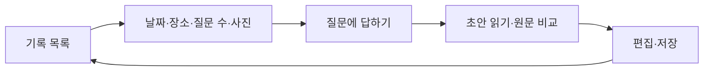

# 사용자 흐름과 화면 설계

이 앱의 목적은 사진을 보며 사용자가 자신의 기억을 꺼내고 그 내용을 글로 남기는 것입니다.
AI가 사진만으로 감정·관계·사건을 확정하는 경험을 만들지 않습니다.
제품 화면은 다음 행동과 사용자 내용에 집중하고 내부 구현 설명은 문서에 둡니다.

## 1. 화면의 흐름

사진은 1~3장, 질문은 1~10개이며 기본 3개입니다. 실제 답변 하나 이상이면 조기에 초안을 만들 수 있습니다.
사진을 대화 중 계속 볼 수 있게 하고 클릭 시 확대합니다. 초안과 저장 기록에서도 질문·원답변을 확인합니다.
저장 전 재작성은 글을 교체할 수 있으므로 명시적 확인 뒤 실행합니다.

## 2. 화면별 책임

| 화면 | 중심 행동 | 함께 제공할 정보 |
|---|---|---|
| 목록 | 새 기억·기존 기록 열기 | 날짜·사진·제목·단계 |
| 업로드 | 사진과 질문 수 선택 | 허용 형식·최대 장수·미리보기 |
| 대화 | 현재 질문에 답하기 | 사진·진행 수·이전 답변 |
| 초안 | 내용 비교·직접 수정 | 원래 대화·작성 출처·재작성 |
| 저장 기록 | 다시 읽기·수정·삭제 | 사진·날짜·원문 |

한 번에 다음 행동을 파악할 수 있게 주요 버튼의 우선순위를 둡니다.
오류는 사용자가 할 수 있는 다음 행동과 함께 안내합니다. 실패했는데 입력 문장을 지우거나 저장 성공처럼 보여 주지 않습니다.
삭제·편집 내용 교체처럼 실제 확인이 필요한 작업에 대화상자를 사용합니다.

## 3. PC·모바일과 접근성

작은 화면은 한 열을 사용하고 긴 문장과 버튼이 가로로 넘치지 않게 합니다.
넓은 화면의 대화·편집은 사진과 입력을 함께 볼 수 있게 배치합니다.
색만으로 단계를 구분하지 않고 텍스트를 함께 표시합니다.
폼에는 설명과 라벨을 연결하고 파일 선택은 드래그만으로 강제하지 않습니다.
확대창은 키보드 닫기와 좌우 이동을 지원합니다. 초점과 닫힌 뒤 복귀도 함께 확인합니다.

글꼴은 포함된 NanumSquareNeo를 로컬로 불러옵니다. 제3자 글꼴 CDN 요청 없이 표시할 수 있습니다.
글꼴 파일과 라이선스를 함께 보관합니다. CSS의 실제 값이 색·간격·폭의 기준입니다.

## 4. 코드의 역할 분리

MemoryApp.js는 상태와 API 흐름을 맡습니다. 단순 표시 부품은 components/memory에 둡니다.
PhotoViewer는 사진 확대, ConversationHistory는 질문·원답변을 담당합니다.
날짜·상태 표시 계산은 memory-display.js에 모았습니다. 서버 업무 규칙은 화면 부품에 넣지 않습니다.

## 5. 범위와 확인

회원가입·공유 피드·GPS 자동 수집·음성·감정 진단은 현재 범위가 아닙니다.
demo는 실제 사진 AI가 아니라는 점을 명확히 표시합니다. ncloud 오류를 demo로 몰래 바꾸지 않습니다.
화면 검수는 작은 화면·긴 답변·느린 응답·키보드·오류·재시도로 진행합니다.
외부 모델의 결과 품질은 화면 배치 검사와 별도입니다. [검증 기록](VERIFICATION.md)에 구분합니다.
