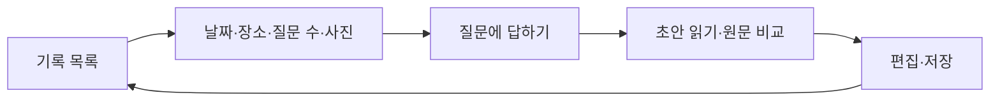

# 사용자 흐름과 화면 설계

사용자는 사진을 보며 기억을 떠올리고 그 내용을 글로 남깁니다. AI는 사진만 보고 감정·관계·사건을 확정하지 않도록 설계했습니다.
화면에는 사용자 내용과 다음 행동을 중심으로 배치하고 내부 구현은 문서에서 설명합니다.

## 1. 화면의 흐름

사진은 1~3장, 질문은 1~10개이며 기본 3개입니다. 실제 답변이 하나 이상이면 질문을 모두 마치기 전에도 초안을 만들 수 있습니다.
대화 중에는 사진을 계속 보면서 클릭해 확대할 수 있고 초안과 저장 기록에서는 질문·원답변도 확인합니다.
저장 전 재작성은 글을 교체할 수 있으므로 사용자가 확인한 뒤 실행합니다.

## 2. 화면별 책임

| 화면 | 중심 행동 | 함께 제공할 정보 |
|---|---|---|
| 목록 | 새 기억·기존 기록 열기 | 날짜·사진·제목·단계 |
| 업로드 | 사진과 질문 수 선택 | 허용 형식·최대 장수·미리보기 |
| 대화 | 현재 질문에 답하기 | 사진·진행 수·이전 답변 |
| 초안 | 내용 비교·직접 수정 | 원래 대화·작성 출처·재작성 |
| 저장 기록 | 다시 읽기·수정·삭제 | 사진·날짜·원문 |

주요 버튼을 눈에 띄게 배치해 다음 행동을 찾기 쉽게 합니다.
오류가 나면 해결할 행동을 함께 안내하고 입력 문장을 유지합니다. 저장에 실패한 상태를 성공처럼 표시하지 않습니다.
삭제·편집 내용 교체처럼 실제 확인이 필요한 작업에 대화상자를 사용합니다.

## 3. PC·모바일과 접근성

작은 화면에서는 한 열로 배치해 긴 문장과 버튼이 가로로 넘치지 않게 합니다. 넓은 화면에서는 사진을 보며 답변하거나 글을 편집할 수 있게 배치합니다.
단계는 색과 텍스트로 함께 표시하고 폼에는 설명과 라벨을 연결합니다. 파일 선택은 드래그 외의 방법도 제공합니다.
확대창은 키보드로 닫고 좌우로 이동할 수 있습니다. 검수할 때는 초점이 어디에 놓이고 닫은 뒤 어디로 돌아가는지도 확인합니다.

글꼴은 포함된 NanumSquareNeo를 로컬로 불러옵니다. 제3자 글꼴 CDN 요청 없이 표시할 수 있습니다.
글꼴 파일과 라이선스를 함께 보관합니다. CSS의 실제 값이 색·간격·폭의 기준입니다.

## 4. 코드의 역할 분리

MemoryApp.js는 상태와 API 흐름을 맡고 단순 표시 부품은 components/memory에 둡니다. PhotoViewer는 사진 확대를, ConversationHistory는 질문·원답변 표시를 담당합니다.
날짜·상태 표시 계산은 memory-display.js에 모으고 서버의 업무 규칙은 화면 부품과 분리합니다.

## 5. 범위와 확인

회원가입·공유 피드·GPS 자동 수집·음성·감정 진단은 구현 범위에서 제외했습니다.
demo 화면에는 실제 사진 AI를 사용하지 않는다는 점을 표시합니다. ncloud에서 발생한 오류를 demo 응답으로 숨기지 않습니다.
화면 검수는 작은 화면·긴 답변·느린 응답·키보드·오류·재시도로 진행합니다.
외부 모델의 결과 품질은 화면 배치 검사와 별도입니다. [검증 기록](VERIFICATION.md)에 구분합니다.
