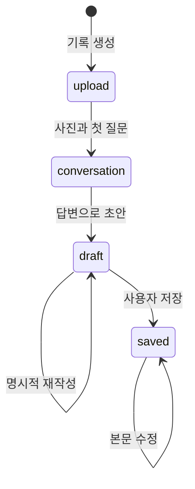

# 2. 서버가 답변을 검사하고 기록으로 남기기

[앞 문서](01-browser-and-request.md)에서 답변 문자열이 JSON 본문에 담기는 지점까지 읽었습니다. 이번에는 같은 `POST /api/memories/기록ID/answers`가 서버에 도착한 뒤 누가 어떤 기록을 바꾸려는지 검사하고 저장하는 과정을 이어 보겠습니다. 브라우저를 다시 조작할 필요는 없으며 같은 테스트 요청과 파일을 함께 봅니다.

```text
answers/route.js: POST
  → app/http.js: appRespond
  → service.js: answer
  → ai.js: nextQuestionTurn
  → repository.js: saveMemory
  → publicMemory로 공개 필드 정리
  → JSON 응답
```

## 2-1. URL에 대응하는 서버 입구 찾기

[answers/route.js](<../../src/app/api/memories/[id]/answers/route.js>)를 엽니다. `[id]`는 실제 기록 ID가 들어갈 자리입니다. URL의 `기록ID`가 어느 값이든 이 경로의 코드가 받아 처리합니다.

```javascript
export async function POST(request, { params }) {
  const { id } = await params;
  return appRespond(request, (owner) => answer(request, id, owner));
}
```

앞에서 본 요청 방식이 `POST`였으므로 이 함수가 실행됩니다. `params`에서 기록 ID를 읽고, `appRespond`를 거쳐 업무 함수 `answer`에 연결합니다. `return`은 처리 결과를 호출한 쪽으로 돌려주는 문법입니다.

파일 맨 위의 `import`는 다른 파일에 정의한 함수를 가져오는 문법입니다. `@/`로 시작하는 경로는 이 프로젝트의 `src`를 기준으로 읽도록 [jsconfig.json](../../jsconfig.json)에서 정했습니다. 이 프로젝트에는 [app/http.js](../../src/lib/server/app/http.js)와 [day1/http.js](../../src/lib/server/day1/http.js)가 모두 있습니다. 이름이 같은 파일은 전체 경로를 함께 봐야 어떤 모듈인지 구분할 수 있습니다.

이 입구 파일은 작습니다. 대화 규칙을 여기서 모두 구현하지 않고 URL 연결, 공통 응답, 실제 처리로 역할을 나누었기 때문입니다. 다음에는 그 연결을 따라가겠습니다.

## 2-2. 누가 어떤 기록에 답하는지 검사하기

[app/http.js](../../src/lib/server/app/http.js)에서 `appRespond`를, [service.js](../../src/lib/server/app/service.js)에서 `answer`를 찾습니다. 공통 응답 함수는 쿠키로 소유자를 구분하고 다른 사이트에서 온 변경 요청과 요청 횟수 등을 검사합니다. 업무 함수는 그 소유자의 기록을 읽어 현재 질문과 단계가 맞는지 확인합니다.

서버는 답변이 문자열인지, 건너뛰기 값이 참거짓인지, 일반 답변이 비어 있지 않고 2,000자 이하인지 검사합니다. 화면에서 입력을 막았더라도 서버 검사는 필요합니다. 사용자는 브라우저 화면을 거치지 않고도 API 요청을 직접 보낼 수 있기 때문입니다.

이처럼 조건에 따라 처리 방향을 나누는 데 `if`를 사용합니다. 다음은 문법을 설명하기 위한 짧은 예시입니다.

```javascript
if (photos.length > 3) {
  throw new Error("사진은 3장까지입니다.");
}
```

`length`는 배열의 항목 수이고 `throw`는 오류를 발생시킵니다. 실제 서비스 함수에서는 사용자가 이해할 오류 코드·상태를 가진 `SafeError`로 잘못된 입력을 알립니다. 다른 사람의 기록은 존재 여부를 노출하지 않도록 404로 처리합니다.

## 2-3. 다음 질문을 만들고 저장한 결과 돌려주기

서버는 이번 답변을 반영한 대화를 준비합니다. 질문 수가 남아 있다면 [ai.js](../../src/lib/server/app/ai.js)의 `nextQuestionTurn` 경로를 통해 다음 질문을 얻습니다. demo에서는 준비된 질문을 사용하고 `ncloud`에서는 CLOVA 요청과 질문 검사를 거칩니다. 이 과정이 성공한 뒤 [repository.js](../../src/lib/server/app/repository.js)에 기록을 저장하고 버전을 올립니다.

여러 질문 중 답한 항목만 고르거나 사진 이름을 모을 때 배열 처리 문법이 나옵니다.

```javascript
const names = photos.map((photo) => photo.name);
```

`map`은 배열 항목마다 작업한 결과로 새 배열을 만듭니다. `filter`는 조건에 맞는 항목을 남기고 `find`는 맞는 항목 하나를 찾습니다. 이 문법을 보면 '각 항목을 바꾸는가, 일부만 고르는가, 하나를 찾는가'를 구분해 읽으면 됩니다.

AI 호출이 실패한 경우 답변과 다음 질문이 모두 저장됐다고 응답하지 않습니다. DB와 AI는 서로 다른 서비스이므로 어느 시점에 저장할지를 서비스 함수가 정합니다. 뒤에서 같은 요청의 재시도와 저장 잠금을 이어 설명합니다.

저장된 기록은 그대로 브라우저에 전달하지 않습니다. [app/http.js](../../src/lib/server/app/http.js)의 `publicMemory`가 화면에 필요한 필드를 골라 `data.memory`에 담습니다. 그런 다음 공통 응답 함수가 `ok`·`data`·`requestId`를 가진 JSON을 만듭니다. 브라우저의 `request` 함수는 이 응답을 읽어 `data`를 반환하므로 앞 문서의 `updateMemory(data.memory)`와 연결됩니다.

답변 한 건이 서버를 돌아온 경로를 읽었으니, 이번에는 기록이 남는 장소와 내 기록을 구분하는 기준을 조금 더 살펴보겠습니다. 이 내용을 알아 두면 나중에 서버를 업데이트할 때 보존해야 할 데이터도 구분할 수 있습니다.

## 2-4. 사진 파일과 일기 데이터는 따로 저장하기

demo는 기본 설정에서 프로젝트의 `.data/memories/`에 기록을 JSON 파일로, `.data/app-photos/`에 사진을 저장합니다. 데이터 폴더는 `APP_DATA_DIR`로 바꿀 수 있으며 기준 경로는 [repository.js](../../src/lib/server/app/repository.js)의 `DATA_ROOT`에서 정합니다. PC를 껐다 켜도 같은 데이터 폴더가 남아 있으면 기록 파일은 남습니다. 앱을 다시 켠 뒤 같은 브라우저 쿠키로 읽을 수 있습니다.

`ncloud`에서는 질문·답변·제목·본문을 PostgreSQL에, 사진 파일을 비공개 Object Storage에 저장합니다. DB에는 사진 파일 자체 대신 사진 ID와 저장 연결 정보가 들어갑니다. 두 저장소를 구분하면 '일기는 있는데 사진이 안 열린다'는 문제를 어느 쪽에서 살펴볼지 판단할 수 있습니다.

PostgreSQL의 `app_memories` 테이블은 기록 객체를 JSONB 형식과 검색용 칼럼에 보관합니다. JSONB는 객체 형태의 데이터를 DB가 처리할 수 있게 저장하는 형식입니다. 현재 구현은 질문 한 개마다 별도 관계형 테이블을 만드는 구조는 아닙니다.

## 2-5. 기록은 어떤 단계를 지나가는가

사진을 준비하던 때와 저장 후에는 할 수 있는 작업이 다릅니다. 서버는 `status`로 현재 단계를 기록하고 순서가 맞는 요청만 받습니다.



`upload`에서는 사진을 추가하고 질문 수를 확정합니다. 대화를 시작해 `conversation`이 되면 답변을 보내거나 건너뛰고 초안을 요청합니다. `draft`에서는 초안을 편집·재작성·저장하며, `saved`에서는 저장된 글을 읽고 직접 수정하거나 삭제합니다.

화면이 목록인지 상세인지는 `view` 같은 화면 상태이고, 기록이 저장됐는지는 `memory.status`입니다. 목록으로 이동한다고 기록이 자동 저장되는 것은 아닙니다. 서버가 보관하는 주요 필드를 읽으면 이 차이가 더 분명해집니다.

| 필드 | 방금 한 실습과의 연결 |
|---|---|
| `id` | URL에서 사용한 기록 UUID |
| `date`, `place` | 처음 입력한 날짜와 장소 |
| `status` | 사진·대화·초안·저장 중 현재 단계 |
| `title`, `content` | 편집하고 저장한 제목과 본문 |
| `photos` | 사진 ID·이름·앱에서 읽을 경로의 배열 |
| `turns` | 질문·답변·건너뛰기를 담은 배열 |
| `questionLimit` | 이 기록을 시작할 때 고른 질문 수 |
| `version` | 성공한 변경마다 증가하는 번호 |
| `createdAt`, `updatedAt` | 생성 시각과 마지막 변경 시각 |
| `mode` | 이 기록을 만든 실행 모드 |
| `draftSource` | `demo`·`ai`·`answers` 등 초안 출처 |
| `preservedAnswerCount` | 원문을 사용한 초안에 남긴 답변 수 |
| `writingModel` | 글 작성 모델, 원문 사용 시 `null` |

서버 내부에는 소유자 해시·실제 사진 저장 키·관찰문도 있지만 일반 응답에 모두 보내지는 않습니다. 앞 문서의 Response에서 보인 기록은 브라우저에 공개할 필드로 정리한 결과입니다.

## 2-6. 로그인 없이 내 기록을 구분하기

현재 앱에는 실명·이메일 회원가입이 없습니다. 처음 접속하면 서버가 무작위 식별값을 `memory_session` 쿠키로 브라우저에 보냅니다. 브라우저는 같은 사이트의 다음 요청에 그 값을 보내고 서버는 SHA-256 해시로 바꿔 기록 소유자와 비교합니다.

이 처리의 실제 코드는 [app/http.js](../../src/lib/server/app/http.js)의 `appRespond`와 [repository.js](../../src/lib/server/app/repository.js)의 `findMemory`에서 읽을 수 있습니다. 해시는 입력값에서 일정한 지문을 계산하는 방식입니다. 이 앱은 기록 소유자를 비교하는 데 사용합니다. 기록 ID만 알면 누구나 읽을 수 있게 만든 구조가 아니므로 다른 브라우저에서 내 기록 ID를 요청해도 자기 쿠키로는 조회할 수 없습니다.

쿠키의 `HttpOnly` 속성은 화면 JavaScript가 직접 읽지 못하게 하고 `SameSite=Lax`는 다른 사이트를 통한 전송을 일부 제한합니다. HTTPS 전환 후에는 `Secure` 속성을 사용해 HTTPS 통신에서만 전송합니다. 만료 설정은 1년이지만 영구 보관이나 복구를 보장하는 기능은 아닙니다.

쿠키를 지우면 DB 기록 자체가 즉시 삭제되지는 않지만 다시 접근할 식별값을 잃습니다. 같은 PC라도 다른 브라우저·시크릿 창은 다른 사용자이며 계정 찾기·쿠키 복구·기기 동기화는 구현하지 않았습니다. 서버 주소를 바꾼 뒤 기록이 없어 보이면 삭제됐다고 판단하기 전에 접속 호스트와 브라우저부터 확인합니다.

`localStorage`에는 이어 쓸 기록 ID만 보관합니다. 전체 일기·사진·인증 정보는 넣지 않으며, 이 ID만으로 소유자 검사를 통과할 수도 없습니다.

## 2-7. 응답이 늦거나 두 창에서 수정할 때

요청을 보낸 뒤 시간이 초과됐어도 서버에서는 처리가 끝났을 수 있습니다. 즉시 여러 번 누르기 전에 목록이나 상세를 다시 조회해 현재 기록을 확인합니다. 서버도 작업별로 중복을 줄이도록 처리합니다.

| 다시 보낸 작업 | 처리 방식 |
|---|---|
| 같은 이름·내용의 사진 | 중복 추가하지 않음 |
| 이미 시작한 기록의 시작 | 현재 기록 반환 |
| 같은 질문에 같은 답변 | 이미 반영했다면 현재 기록 반환 |
| 이미 답한 질문에 다른 답변 | 충돌 안내 |
| 일반 초안 요청 | 기존 초안·저장 기록 반환 |
| 명시적 초안 재작성 | `draft` 단계와 최신 `version` 검사 |
| 제목·본문 저장 | 최신 `version`일 때 반영 |

`version`은 클라이언트가 임의로 올리는 숫자가 아닙니다. 서버가 성공한 변경마다 올리고 다음 저장 때 화면이 읽었던 번호와 비교합니다. 두 창에서 같은 글을 열어 한쪽이 먼저 저장했다면 오래된 창의 저장은 409 충돌로 막습니다. 최신 기록을 다시 열고 자신이 편집한 내용과 비교해야 합니다.

[repository.js](../../src/lib/server/app/repository.js)의 `withMemoryLock`을 열면 같은 기록의 변경을 큐로 순서 정하는 코드를 볼 수 있습니다. 큐는 앞 작업이 끝난 뒤 다음 작업을 시작하도록 줄을 세웁니다. `ncloud`에서는 DB 트랜잭션과 advisory lock도 사용합니다. 트랜잭션은 여러 DB 변경을 성공 시 함께 확정하고 실패 시 되돌리는 단위입니다. 다만 외부 AI 과금이나 사진 저장소까지 한 DB 거래로 되돌릴 수는 없습니다.

업로드 후 DB 저장이 실패하면 새로 저장한 사진을 정리하려고 시도합니다. 삭제는 사진을 먼저 지우고 DB 기록을 지우므로 외부 삭제 일부가 실패하면 재시도할 기록이 남고 일부 사진은 이미 없을 수 있습니다. 모든 외부 작업이 언제나 정확히 한 번만 실행된다는 보장은 없습니다.

처리량도 제한합니다. `ncloud` 동시 쓰기는 프로세스당 최대 2개, DB 연결 풀은 최대 3개입니다. 소유자별 변경은 분당 60회, 실제 AI는 분당 12회로 제한합니다. 메모리 기반 제한이므로 여러 앱 서버 전체의 통합 제한은 구현하지 않았습니다.

여기까지 읽으면 입력창의 글, 서버에 저장된 답변, 최종 저장된 일기가 각각 언제 바뀌는지 구분할 수 있습니다. 다음 문서에서는 이 경로 중 `nextQuestionTurn`과 `makeDraft`가 실제 AI를 연결할 때 어떤 자료를 보내고 결과를 검사하는지 살펴봅니다.

[이전: 브라우저 입력과 요청](01-browser-and-request.md) · [다음: 사진 처리와 AI](03-photos-and-ai.md)
